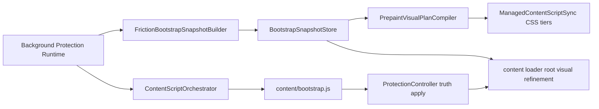

# Bootstrap Friction Snapshot Architecture

- Status: Active
- Date: 2026-03-09
- Scope: canonical bootstrap friction/root-visual documents and their prepaint handoff under the storage boundary
- Primary source files:

- Owner: nudge runtime
- Last validated against code: 2026-10-13
- Path policy: planning-allowed
- Canonical for: bootstrap friction snapshot assembly and handoff architecture

  - `src/platform/storage/bootstrap/BootstrapSnapshotRepository.js`
  - `src/domains/protection/background/runtime/PrepaintVisualPlanCompiler.js`
  - `src/domains/protection/content/prepaintVisualRuntime.js`
  - `src/apps/content/loader.js`
  - `src/apps/content/bootstrap.js`
  - `src/apps/content/bootstrapController.js`
  - `src/domains/protection/background/TrackingProtectionService.js`
  - `src/domains/protection/background/ProtectionDispatcher.js`
  - `src/apps/background/services/boot/BootPrewarmService.js`
- Companion docs:
  - `docs/architecture/runtime/friction-filter-injection-architecture.md`
  - `docs/architecture/runtime/content-runtime-target-architecture.md`
  - `docs/architecture/storage/storage-architecture-target.md`
  - `docs/system-architecture/02-runtime-storage-boundaries.md`

## 1) Why This Exists

The project has a document-start friction bootstrap path and small snapshot helpers:

- `loader.js` runs from content at `document_start`
- `src/platform/storage/bootstrap/BootstrapSnapshotRepository.js` stores small background-owned friction and root-visual snapshots

That is useful, but still not ideal:

1. content-side settings reads on the hot path create duplicate policy interpretation
2. JS bootstrap can still arrive after the first page paint
3. root visual refinement must not compound with prepaint CSS
4. the distinction between dashboard boot prewarm and content friction bootstrap must remain explicit

This document defines the canonical surfaces `bootstrap.friction`, `bootstrap.root_visual`, and the rebuild boundary `bootstrap.cache_generation` with a dedicated store, builder, projection, and ownership model.

## 2) Target Principle

`bootstrap.friction` and `bootstrap.root_visual` are not a second settings system.
They are tiny derived boot caches for content startup and prepaint/root visual handoff.

Rules:

1. background is the only writer
2. content loader/runtime and managed content script registration are the readers
3. the surface is small, TTL-based, and rebuildable
4. it may never depend on IndexedDB on the read path
5. it must be safe to invalidate and regenerate at any time
6. `ManagedContentScriptSync` computes registration + catch-up targets only
7. `ContentScriptOrchestrator` is the only runtime owner allowed to perform content catch-up injection
8. no secondary compatibility registration id layer should be retained in active code
9. final content runtime state machine and owner boundaries are governed by `docs/architecture/runtime/content-runtime-target-architecture.md`
10. background prepares the current cache generation before prepaint projection; a missing or different generation deletes both derived documents and records only the current generation

Evolution mode:

- `rebuild`

## 3) Separate It From Dashboard Prewarm

Do not merge this with `BootPrewarmService`.

`BootPrewarmService` exists for dashboard boot warmup.
`bootstrap.friction` exists for content `document_start` friction bootstrap.

They are both derived boot caches, but they serve different consumers and different latency budgets.

Required distinction:

- dashboard prewarm: broad, multi-section snapshot for options UI
- friction bootstrap: tiny host-focused snapshot for content fast path
- dashboard-driven content debug delivery도 탭에 직접 주입하지 않고 background orchestrator를 통해 전달한다

## 4) Target Architecture



## 5) New Modules

### 5.1) `BootstrapSnapshotStore`

Recommended file:

- `src/platform/storage/bootstrap/BootstrapSnapshotRepository.js`

Responsibilities:

- read/write the canonical `bootstrap.friction` document in `chrome.storage.local`
- validate schema version
- validate TTL
- enforce size and field normalization
- expose a small API:
  - `getFrictionSnapshot({ hostname, now })`
  - `setFrictionSnapshot(snapshot)`
  - `clearFrictionSnapshot({ hostname? })`

### 5.2) `FrictionBootstrapSnapshotBuilder`

Recommended file:

- `src/domains/protection/background/runtime/FrictionBootstrapSnapshotBuilder.js`

Responsibilities:

- build small bootstrap documents from already-known background state
- derive only what content bootstrap and root visual prepaint need
- avoid querying IndexedDB

### 5.3) `FrictionBootstrapCoordinator`

Recommended file:

- `src/domains/protection/background/runtime/FrictionBootstrapCoordinator.js`

Responsibilities:

- decide when to refresh/invalidate bootstrap snapshots
- react to settings changes, tab updates, protection dispatches, and active-tab changes
- keep write frequency bounded

## 6) Target Snapshot Contract

Canonical storage key:

- `bootstrap.friction`

Schema:

```js
{
  schemaVersion: 1,
  generatedAtEpochMs: 0,
  staleAfterEpochMs: 0,
  host: {
    hostname: 'example.com',
  },
  decision: {
    shouldApply: true,
    isBlockedDomain: true,
    reason: 'blocked_domain',
    rulesMode: 'managed',
    filteringMode: 'blocklist',
  },
  visual: {
    filters: {
      blur: null,
      saturation: null,
      contrast: null,
      textRhythm: null,
      textShadow: null,
    },
  },
  runtime: {
    clickDelay: null,
    scrollFriction: null,
    inputVisualBrake: null,
    navigationButtonLock: null,
  },
  meta: {
    source: 'background-protection-runtime',
    revision: 0,
  },
}
```

Contract rules:

1. the document must be host-scoped
2. the document must not include full settings dumps
3. the document must include only the minimal bootstrap inputs
4. host mismatch or expiry means “ignore”
5. content must not read settings as a fallback for policy decisions
6. an active `textRhythm.value` is the exact materialized runtime profile; physical text child keys and separate shuffle settings are not snapshot fields

Companion root visual contract:

- `bootstrap.root_visual` is derived from the same normalized snapshot write
- it contains only `rootFilter`, `visualFilters`, and minimal metadata; executable runtime filters remain in `bootstrap.friction`
- `rootFilter` is always a string. `decision.shouldApply` describes the general protection decision; `rootFilter: ''` is a valid no-root-visual plan when only runtime or element effects apply. The loader suppresses prepaint and restores any owned prior preload before continuing bootstrap. Missing or non-string root filters remain explicit contract errors.
- prepaint CSS registration may only project from fresh `bootstrap.root_visual` entries
- prepaint registration must use host-exact matches, never `*://*/*`

## 7) Storage Strategy

Backend:

- `chrome.storage.local`

Namespace:

- `bootstrap.cache_generation`
- `bootstrap.friction`
- `bootstrap.root_visual`

Retention:

- short TTL, recommended 5 to 15 minutes
- bounded document size
- no historical archive

Evolution:

- `rebuild`
- no prior cache generation or previous root-visual shape is interpreted
- generation mismatch removes only the two rebuildable snapshot documents; durable settings, statistics, and security metadata are untouched

Projection rule:

- `PrepaintVisualPlanCompiler` may derive CSS tier plans from `bootstrap.root_visual`
- it must not read settings or recompute domain policy
- if the root visual entry is missing, stale, inactive, or has no `rootFilter`, no prepaint plan is produced
- the compiler consumes normalized `listRootVisualSnapshots()` array entries;
  malformed present entries fail instead of being treated as empty or legacy
  root-visual shapes

## 8) Read Path

Target document-start read path:

1. dynamic CSS content scripts apply coarse prepaint visual tiers before JS bootstrap
2. `loader.js` loads `bootstrap.root_visual` by hostname
3. fresh active root visual entries suppress CSS prepaint and apply exact inline root filter
4. inactive/missing/stale entries suppress CSS prepaint and apply nothing
5. `ProtectionController` suppresses CSS prepaint before authoritative apply/clear

Important target:

- content must no longer be the canonical writer of the bootstrap snapshot
- content must not read full settings for startup policy fallback

## 9) Write/Invalidate Path

Writers:

- background only

Refresh triggers:

1. successful protection update dispatch for a tab
2. settings change that affects bootstrap friction or root visual projection
3. active tab change
4. tab URL change or completed navigation
5. quantized cooling state changes on the existing minute tracking ingress
6. unchanged-step entries approaching the existing ten-minute TTL

`CoolingCurveStepRefreshCoordinator` reads real protected web tabs and one passive
background curve projection per host. State changes use the existing exact-ACK
dispatcher for every same-host tab. Both state changes and TTL renewals refresh
through `ProtectionDispatcher.refreshFrictionBootstrapForHostname`, followed by
the existing managed-registration tail without open-tab injection. TTL renewal
alone sends no content message. Failed ACK/write/registration leaves the state
retryable on the next existing tick.

The fresh runtime read is fenced by the canonical settings change version.
`FrictionBootstrapCoordinator` serializes writes and invalidation, checks its
invalidation epoch and the supplied version fence around the companion writes,
and clears a superseded write before reporting failure. A stale cleanup cannot
erase a later serialized write. The cache remains derived and ten-minute bounded;
it is not prolonged to an activity day.

P1-C uses current cache generation 5; its existing rebuild owner discards only
the two derived documents when the generation differs. The runtime curve state
and compiled modifiers are the same as envelope V2. A compiled Lens scale is
retained as exact `frictionModifierScale` provenance until visual materialization,
so prepaint, bootstrap and authoritative application scale once. Content never
recomputes budget progress or reads settings to repair a missing cache.

Invalidate triggers:

1. settings change removing bootstrap friction applicability
2. host change
3. an explicitly approved post-release contract change that requires cache rebuild
4. explicit reset/support action

Write throttling:

- allow best-effort coalescing per hostname
- do not write on every tick if the effective bootstrap payload is unchanged

## 10) Release V1 Status

The current bootstrap snapshot is the first release contract, not the result of
an upgrade chain:

1. `BootstrapSnapshotRepository` is the canonical storage entrypoint.
2. background is the sole writer.
3. prepaint CSS tiers and root-visual refinement consume the exact release V1
   snapshot shape.
4. missing entries enter the explicit cold-start path; malformed or
   wrong-contract entries fail loudly.
5. normal runtime contains no prior-key read, previous-shape conversion,
   cleanup write, or snapshot migration.

## 11) Test Plan

Required tests:

1. hostname mismatch returns null
2. expired snapshot returns null
3. fresh root visual snapshots are listable for prepaint projection
4. prepaint plans are derived only from active root visual entries
5. managed CSS registrations are host-exact even in global permission mode
6. background writer updates snapshot on protection dispatch or relevant settings change
7. only the release V1 snapshot key and exact record shape are written
8. malformed and wrong-contract records fail loudly
9. a generation mismatch is handled before background prepaint reads by deleting the rebuildable caches, not by a legacy-shape read or conversion

## 12) Non-Goals

Do not do these in the same change:

1. redesign dashboard boot prewarm
2. add analytics or telemetry fields to the bootstrap document
3. turn the bootstrap cache into a general rule engine

## 13) Completion Criteria

This plan is complete when all of the following are true:

1. `bootstrap.friction` exists as a named canonical storage surface
2. background is the only writer
3. `bootstrap.root_visual` drives prepaint projection and loader refinement
4. snapshot contents are minimal and rebuildable
5. content startup has no full-settings policy fallback
6. no prior-key or previous-shape interpretation exists in normal runtime
7. `bootstrap.root_visual` contains no unused runtime-filter projection

## Settings invalidation (2026-09-05)

`settings/config/bootstrapSnapshotInvalidation.js` owns semantic change classification.
Indicator/debug, collection telemetry, and controller-only feature changes preserve
snapshots and skip prepaint registration sweeps. A bare `filterSettings` change,
early-effect change, global policy/control change, or full reconcile invalidates
the global dependency scope before broadcast. Permission authority remains with
the managed registration owner's current grant/scope intersection and exact-document
teardown; a cached snapshot never grants injection authority.

`SettingsPersistenceCapability.set` derives changed domains for `siteGoals`,
`siteGoalMeta`, and `siteRuleTimeline` from the committed before/after maps. It emits
`bootstrapHostChange:<setting-key>:<URI-encoded JSON domain array>` beside the
physical key. This is propagation metadata, never a stored settings key or policy
source. The typed session propagation checkpoint carries it across worker restart.
Coalescing unions scoped metadata. Mixing a whole-key change into a scoped batch
adds an explicit JSON `null` scope marker, preserving full invalidation. The dispatch
planner excludes this metadata from effect-key judgment.
The analogous `bootstrapFullFilterChange` marker preserves a whole-filter change
when coalesced with feature-specific metadata. Unclassified runtime keys also
invalidate globally; only explicitly classified unrelated keys preserve snapshots.

`FrictionBootstrapCoordinator.invalidateForSettingsChange` reads the host union
from repository `listFrictionSnapshots` and `listRootVisualSnapshots`, uses the
canonical site alias/subdomain matcher, and clears matching hosts through the typed
store. Sequential clears preserve read/modify/write order. It returns `scope` and
`invalidatedHosts`. Global invalidation deletes directly without inspecting old
entries, so malformed caches cannot block OFF; its host count is explicitly unknown
(`invalidatedHosts: null`). Unaffected hosts retain their expiry and revision: neither global
revision replacement nor TTL extension occurs. Missing/expired/new hosts remain
cold. Catalog/assignment changes retain global dependency scope because these
snapshots deliberately do not store a second preset dependency graph.
