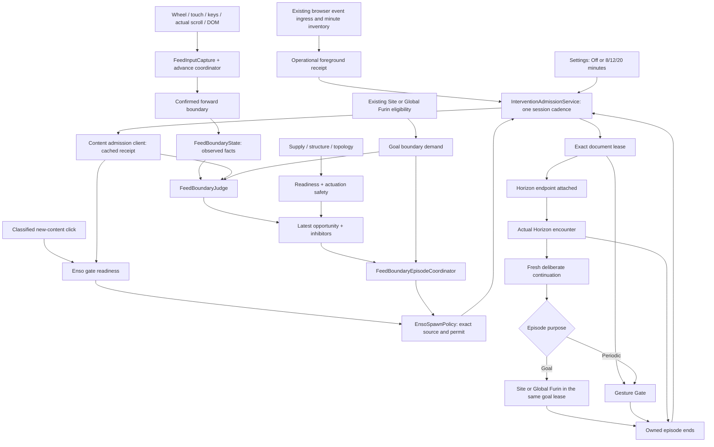

# Feed Flow Runtime Target Architecture

- Status: Active
- Owner: shared feed-boundary runtime / Enso interaction runtime / protection content runtime
- Last validated against code: 2026-10-13
- Path policy: planning-allowed
- Canonical for: content-boundary observation, periodic and goal feed opportunities, topology/readiness/safety, shared endpoint episode ownership, and offline model isolation.

## Product contract

The public owner is **Barrier -> Consumption interval** (`소비 간격`), located
in Tools. Both the classified-click and feed routes use that control. This
technical contract retains Enso-named execution owners and cadence identifiers;
the Zen Enso artwork is Veil's separate presentation, not the periodic setting.

Enso offers a reflection after a selected amount of operational foreground consumption across protected sites. A due interval arms the next supported content boundary; it does not interrupt an item on a timer. The time is an operational approximation, not an attention, addiction, intent, or content-quality measurement. Rapid browsing does not shorten the selected interval.

The public choice is Off / 8 / 12 / 20 minutes, with 12 minutes the default. Off preserves the selected preset. These values are product hypotheses, not empirically established optimal intervals. Settings persist through the canonical settings command and typed store boundaries. `ensoIntervalPolicy.js` is the only interval definition; the compiled click and feed effects receive the same `intervalMs`.

The background admission service owns consumption time and shared intervention ownership. This document owns the local boundary and endpoint; [intervention-admission-runtime.md](intervention-admission-runtime.md) owns the global clock, foreground, lease, recovery and restart contract. [tracking-consumption-facts.md](tracking-consumption-facts.md) owns the existing operational browser facts reused by the cadence bridge.

Site and Global Furin also use this boundary infrastructure. On a qualified feed,
Horizon must precede automatic Furin even when periodic Enso is OFF. Goal demand
does not enable Enso, change its interval, or invent a due cadence receipt. The
shared coordinator owns placement, phase transitions and cleanup; existing
background owners retain goal eligibility, current-policy cancellation and daily
delivery. The remaining cooling curve and Horizon-only site ending are
tracked separately in [Cooling Curve Runtime](cooling-curve-runtime.md).

## Actual runtime flow

A receipt or timer callback never replays an input or creates a new content boundary. Supply scans can maintain or invalidate a still-fresh candidate and complete a previously requested lease; they cannot manufacture consumption or a new opportunity.

## Canonical owner table

Paths below are repository-relative. Feed owners without a full prefix are under `src/domains/nudge/feed-flow/`.

| Concern | Canonical owner | Authority / output |
| --- | --- | --- |
| User interval | `src/domains/settings/config/ensoIntervalPolicy.js` | Three exact current presets; predecessor values reject without a hydration rewrite |
| Settings to runtime materialization | `src/domains/protection/background/runtime/EnvelopeAdapter.js`, `src/domains/protection/content/ProtectionRegistry.js` | Exact interval config; click activation remains boolean at InteractionManager API |
| Public controls | `src/apps/dashboard/hooks/artifactSettings/useBarrierArtifactSettingsFamily.js`, `src/apps/dashboard/tabs/tools/artifactCards/buildBarrierCard.jsx` | Off/8/12/20 in public Tools; no model score or intensity setting |
| Operational event acquisition | `src/domains/tracking/background/trackingEnsoCadenceBridge.js` and existing browser/tick owners | Confirmed foreground intervals; independent of history collection consent |
| Global time and admission session | `src/domains/protection/background/runtime/InterventionAdmissionService.js`, `ensoCadencePolicy.js` | Single cadence writer in existing session checkpoint; no content extrapolation |
| Content receipt and lease transport | `src/domains/nudge/runtime/interventionAdmissionClient.js` | Exact document control push/read, stale receipt rejection, lease lifecycle |
| Producer lifetime and supply beat | `FeedObservationRuntime.js` | One document producer shared by history and intervention; 250 ms existing beat |
| Runtime composition | `index.js` | Capture, coordinator, factual state, judge, topology and publication; no pressure model |
| Configuration | `config/ensoFeedHorizonRuntimeConfig.js` | Strict v4 config: interval, sensing, behavior inhibition windows |
| Input intent and actual displacement | `capture/FeedInputCapture.js`, `resolve/ActiveScrollContainerResolver.js` | Native scroll container and input facts; app-owned scroll writes excluded |
| Confirmed forward movement | `confirm/FeedAdvanceCoordinator.js`, `ContinuousAdvanceAdapter.js`, `PagedAdvanceAdapter.js`, `HybridAdvanceAdapter.js` | One canonical advance event; native snap and fresh item transitions stay distinct from wheel intent |
| Independent continuous reference acquisition | `discovery/FeedContinuousReferenceDiscovery.js` | Same-scroller viewport semantic boundary plus complete structural qualification; missing shipped match alone grants no authority |
| Local factual state | `session/FeedBoundaryState.js` | Counts, last boundary, reference node and behavior context; no dose, maturity, pace or idle reset timer |
| Boundary policy | `judge/FeedBoundaryJudge.js` | Independent goal demand or background periodic due, plus new confirmed forward advance and current inhibitors; pending boundary expires after 5 s; goal demand never changes the cadence receipt |
| Supply observation | `supply/FeedSupplyProbe.js` and its lifecycle owners | Availability and structure only; offscreen supply addition is not user progression |
| Mutation supply admission | `discovery/GenericFeedItemDiscovery.js` → `confirm/FeedAdvanceCoordinator.js` | `observeMutations`: revalidation demand + observation completeness; optional complete fresh-supply count is not a consumed-item count |
| Surface capability | Surface profiles, `learning/FeedStructureLearner.js` | Site structure declarations and bounded session learning; not consumption quality |
| Topology certification | `topology/FeedTopologyCertificationRuntime.js`, `FeedTopologyPersistentCertificationService.js` | Exact structural certificate and revocation; historical tempo checkpoint has no runtime authority |
| Physical safety | `actuation/FeedActuationSafetyJudge.js`, `FeedEndpointBoundaryResolver.js`, `FeedShippedTopologyProbe.js` | Supported placement and current geometry; uncertain topology stays observe-only |
| Local feed eligibility | `src/domains/nudge/interaction/ensoFeedEpisodeAdmission.js`, `EnsoFeedSurfaceEntryGrace.js` | Due receipt + fresh opportunity + topology/safety + semantic surface grace |
| Source and permit ownership | `src/domains/nudge/interaction/EnsoSpawnPolicy.js` | Click/feed mutual exclusion, exact permit, presentation identity; no cooldown clock |
| Shared feed episode lifecycle | `FeedBoundaryEpisodeCoordinator.js` | One actuation consumer and Terminus owner for periodic reflection or Site/Global goal prelude; candidate, reservation, attachment, encounter, exact continuation and cleanup |
| Periodic Enso entry | `src/domains/nudge/interaction/EnsoRuntimeEpisodeManager.js` | Thin re-export of the shared class/singleton; existing periodic apply/remove API, with no second actuator or observer |
| Automatic Furin screen/action evidence | `src/domains/nudge/runtime/furinEntryBoundary.js`, `src/domains/nudge/runtime/nudgeEntrySeamGate.js`, `src/domains/protection/content/ProtectionController.js` | Qualified feeds require Horizon; declared non-feed new-content action requires a synchronously consumed prepared permit; unknown/mixed primary-media evidence waits |
| Goal identity and cancellation | `src/domains/nudge/runtime/goalEpisodeBinding.js`, `src/domains/protection/background/protocol/dispatch/ProtectionGoalEpisodeInvalidator.js` | Fresh background goal policy at privileged transitions; exact cancelling owner and cleanup; shared feed coordinator does not compute goal facts |
| Host/day delivery readout | `src/domains/protection/runtime/goalEndSummary.js`, `src/domains/protection/contracts/goalEndSummaryContract.js` | Passive typed daily/session facts through the runtime snapshot; current attainment, waiting/unsupported/error/cancelling and actual final renderer; no admission authority |
| Endpoint geometry / motion / experience | `terminus/FeedTerminusController.js`, `FeedEndpointLease.js`, `FeedEndpointBoundaryMotion.js`, `TerminusSurface.js` | Existing readable boundary and native scroll experience; transactional teardown |
| Click boundary and presentation | `src/domains/nudge/interaction/ensoGateReadiness.js`, `src/domains/nudge/interactionManager.js` | Latest due receipt at classified new-content click; exact presentation and replay ownership |
| Click action semantics | `src/domains/nudge/interaction/ClickBoundaryClassifier.js`, `clickTargetResolver.js`, `interactionTargetProfiles.js` | Owner-declared current-content controls and explicit utility/escape controls cannot be promoted by surrounding card/media evidence |
| Surface arbitration | `src/domains/nudge/runtime/ritualSurfaceArbiter.js` | Local screen ownership; background admission remains cross-tab authority |
| Visual gesture timing | `src/domains/nudge/interaction/EnsoGateTimeline.js` | Presentation/gesture timing only; no eligibility or cooldown |
| Diagnostics | Runtime debugger, protection diagnostics, decision/episode snapshots | Cadence receipt -> boundary -> inhibitors -> admission -> lease -> actual presentation; read-only |
| Offline models | `scripts/dev/enso-model-research/README.md` and boundary guard | Legacy burst/judge/seam/tempo/attention experiments; no production incoming imports |

## Time and lifetime invariants

History enable commits its allowed state only after its accumulator successfully
creates the producer generation. `FeedObservationRuntime` and the feature facade
commit their corresponding flags after that call; revocation remains immediate.
Failure to create identity is explicit and a later enable retries initialization.
Default producer/topology IDs use the shared cryptographic UUID primitive that
also works in HTTP content; UUID creation does not establish history consent.

`FeedObservationRuntime` owns the supply timer's visibility lifetime. A hidden
document parks only its 250 ms interval; producer identity, history demand,
intervention demand, probe listeners and episode state remain intact. Visibility
restoration takes one current supply sample and resumes the same 250 ms beat,
without replaying hidden elapsed time. Each interval lease rejects callbacks
already queued before parking. Repeated visibility events do not create another
timer. `pagehide` still stops the producer, and visibility alone cannot restart
that BFCache-suspended producer; `pageshow` remains its restart owner.

1. The background receipt is the only time-eligibility authority. It has `version`, `eligible`, `consumedMs`, `intervalMs`, `remainingMs`, `observedAt`, `reason`, `revision`. Content does not turn elapsed wall time into consumption.
2. Confirmed foreground protected-site exposure while the browser is focused accumulates globally. Changing protected domains or tabs does not create another budget. Background audio, blur and locked time do not accumulate. Native idle alone does not stop this clock: it cannot distinguish quiet reading/video from abandonment. An unattended foreground tab can therefore become due, but return alone cannot trigger presentation. This is an explicit product tradeoff, not an attention measurement.
3. A read never advances the clock. The existing minute inventory and exact browser ingress close known intervals. Unknown gaps over 120 s are not extrapolated. Worker restart retains confirmed totals but requires a new observation anchor. Analytics consent does not disable operational friction.
4. A confirmed operational departure of 10 minutes starts a fresh period. A 5-minute detour pauses it. Unknown absence is not proven rest. Site-local display suppression does not create a second clock.
5. Actual completion of an automatic Enso, Furin or ordinary Shishi reflection starts a fresh period. A Furin-owned Horizon encounter starts actual occupancy and whole-episode recovery when ended, but only actual final Furin presentation earns its reflection credit. Manual QA, failed candidate delivery, cancelled reservation and attached-but-unseen endpoint do not consume/reset it. Only actual displayed ownership suppresses consumption accumulation.
6. Due time saturates at the selected interval: there is one pending opportunity and no backlog. Increasing the interval requires the missing additional amount; time spent waiting beyond the old cap is not banked. Decreasing it can make the next boundary eligible. OFF starts a new period when re-enabled.
7. Content caches are transport projections: a receipt older than 90 s is unavailable. Entry/settings/visibility and bounded later reads refresh through the same background owner. No new content timer is added for time eligibility.
8. Receiving a foreground/focus callback cannot itself create an opportunity. Periodic feed Enso retains the 2-minute semantic surface entry grace. A goal-owned prelude does not wait for an Enso interval/grace, but still requires new confirmed forward motion and the same current inhibitors, topology and placement safety. Click requires an eligible new-content action. There is no extra source cooldown or mandatory maximum waiting deadline.

## Observation and current-boundary contract

### Mutation supply admission (2026-09-18)

`GenericFeedItemDiscovery.observeMutations` returns `{ complete, reason,
needsRevalidation, freshItems, mutationRoots, candidateCount, visitedElements }`.
The coordinator consumes `needsRevalidation`; it never derives advancement from
the supply count. The offline DOM evaluator is the remaining numeric consumer
and rejects incomplete observations without changing its independent oracle.
`freshItems` counts novelty within the existing surface-local identity window
only when complete; it is `null` when observation or baseline coverage is incomplete.
It is neither a lifetime unique-item total nor evidence of exposure.

Continuous mutation handling reconciles programmatic scroll writes, then exits
before supply discovery. Continuous seed/reset retains the visible-reference
baseline and skips the document supply seed. `setSurface` and `reset` clear the
discovery identity state; entering paged/hybrid/unknown seeds the current DOM
again. `stop` clears that state and the coordinator's existing pending scans.
The offline evaluator may instead observe first-seen supply from an empty
identity history immediately after `setSurface`.

The document seed visits at most 200 Elements and each mutation batch visits at
most 40 Elements across minimal roots. These are explicit traversal visits,
not selector-engine internal visits, returned NodeList sizes or CPU budgets.
Discovery does not materialize a full QSA list. Declared and semantic item
boundaries own nested presentation and prune that traversal; generic wrapper
resolution still uses the shared boundary seam on a complete candidate tree.
Selector matches, generic feature/identity reads and root normalization remain
synchronous and are not bounded by elapsed time.

Exhaustion produces `visit_limit`; later observations after an incomplete seed
produce `seed_incomplete` until a new complete seed/reset boundary. Neither a
truncated candidate tree nor an unseeded old node is committed as fresh identity.
The coordinator admits incomplete supply to its existing immediate/settled
dominant revalidation, retaining gesture, geometry, identity and scroll-write
guards. This is an explicit incomplete-admission design, not a continuation or
an eventual exact-count guarantee. Large unrelated batches can therefore
request a conservative dominant recheck. Invalid explicit selectors produce
`invalid_selector` diagnostics and no guessed supply revalidation request.

Known-item attribute/text/child changes and removal records can request
revalidation even with a complete zero novelty count. Text itself never becomes
a content identity. `mutation_scan` debug counters separately record incomplete
observations, revalidation requests and explicit visits; `freshItemCount` sums
complete observations only. Debug timing does not run when the ledger is off.
This describes the discovery input contract. `FeedInputCapture` still subscribes
to childList/subtree changes only; attribute-only and characterData-only delivery
is not newly enabled or certified here. Later input/dominant scans retain their
own identity reads.

Regression owner: `tests/feedSupplyObservation.test.js`, complemented by the
existing natural DOM, observation, scroll-write and independent fixture tests.
These jsdom checks do not certify Chromium layout or a real-site QA PASS.

### Current boundary facts

- Intent, actual scroll, confirmed item transition, supply availability and media state remain separate facts. Adapters own conversion to a single advance event. Hybrid arbitration must not replay old displacement alongside a new paged transition.
- Continuous movement uses measured screenful displacement; paged movement uses confirmed new item transitions. These are boundary evidence, not exchangeable addiction-score units. Factual counters are diagnostic.
- Offscreen DOM growth alone does not advance consumption. Reverse intent/revisit and current typing/selection/click-through inhibit a pending opportunity. The 12-second windows protect the immediate action; they do not measure mental state.
- The current unreserved decision is recomputed on the existing beat and actual activity. A 5-second pending boundary cannot survive as a frozen admission candidate. When it expires or is invalidated, only a new confirmed forward event can reopen it.
- Long-form document surfaces remain excluded from feed endpoint placement. Long content does not have a timed forced cutoff. A supported endpoint can be placed beyond the current readable item and wait while the item is read.
- Missing dwell stays null. No cadence receipt means unavailable, not zero use. Existing structural unknown/observe-only states remain explicit. Legacy DTO fields retained for structural/history compatibility do not restore score authority.

## Candidate, attachment, encounter and end

### Horizon and Gesture Gate user flow

Horizon and the Enso Gesture Gate are two stages of one feed intervention.
Horizon supplies a readable endpoint between items; the Gate asks about a later
attempt to continue beyond it. A structural insertion boundary, an input pause,
and a renewed action are separate facts. Production does not require the retired
relative-rhythm seam detector before inserting Horizon.

The user can finish the content already in view, reach the endpoint, stay there,
or move backward. Placement preserves the last visible candidate item (or its
complete row) and requires the existing topology/geometry checks. A due interval,
endpoint attachment, boundary encounter or elapsed still-gate duration cannot
by itself display the Gesture Gate. Non-feed content-entry links supply their
own action boundary and retain the existing click admission path; they do not
gain another silence requirement or a Horizon surface.

The feed continuation sequence is:

1. The due receipt and a confirmed forward advance admit a safe endpoint.
2. The user reaches Horizon; this reports the single episode's encounter.
3. The arriving input finishes. Existing episode-local still-gate timing remains
   a minimum preparation duration, not evidence that the user stopped.
4. A fresh forward gesture, begun after preparation, may accumulate the existing
   deliberate pull threshold and open the Gesture Gate on that input.
5. Enter restores continuation through the same episode. Neutral preserves
   Horizon but requires another fresh gesture; backward input clears pending
   pull evidence and remains native. Existing leave/teardown ownership remains.

`src/domains/nudge/feed-flow/terminus/HorizonContinueGesture.js` owns only this
input grouping. Wheel bursts are separated by at least 350 ms without a forwarded
wheel input; every arriving/withheld wheel event updates that boundary. An
uninterrupted burst cannot become accepted merely because preparation elapsed.
Wheel silence is a conservative heuristic: browser wheel events do not provide
a portable momentum-end phase, so it is not proof of a new conscious intention.
Keyboard repeat cannot start a gesture, but repeats of a newly admitted key press
can complete its pull. Pointer pulls carry an explicit per-press identity and
start time; holding the same drag across a pause cannot start a fresh gesture.
Pointer end/cancel/reversal and backward input clear continuation evidence.

`FeedEndpointLease` labels the existing wheel callback and transports keyboard
and pointer facts through `FeedEndpointBoundaryMotion`; these physical owners do
not judge Enso eligibility. `FeedTerminusController` combines the gesture result
with current encounter/preparation state and the existing pull accumulator.
Only an accepted input crossing the threshold calls the episode continuation
callback. Render frames, quiet time, stale pull state and programmatic geometry
reconciliation cannot open the Gate. No additional polling, DOM observer,
consumption clock, persisted setting or independent intervention is introduced.

Focused controller, surface, motion, lease and DOM integration tests protect
arrival-burst rejection, fresh input, neutral rearming and native editor/retreat
behavior. They do not certify real-device wheel inertia or real-site rendering.

### Shared Horizon before automatic Furin (P1-A)

`FeedBoundaryEpisodeCoordinator` is the single endpoint lifecycle owner. Its
periodic producer retains `resolveEnsoFeedEpisodeAdmission`, `EnsoSpawnPolicy`
and the independent Barrier choice. Its goal producer accepts
`requestGoalEntry({ kind, purpose, runId, goalBinding, onContinue, onCancelled })` and exact
`cancelGoalEntry` teardown. `getGoalEntrySnapshot` reports exact run/kind/purpose,
lease and encounter/handoff state; it neither calculates a goal nor writes daily
delivery. The Filter status reads the separate host/day `goalEndSummary` below.

`FeedFlowRuntime.setGoalBoundaryDemand` and `FeedBoundaryJudge.setGoalDemand`
admit observation for a pending goal without modifying the real cadence DTO.
One goal demand can arm a fresh safe boundary with Enso OFF or Barrier paused.
It does not enable a disabled filter. Supply may complete an already fresh
reservation; it cannot create an opportunity. An existing ordinary episode
keeps its purpose, lease and endpoint; goal demand cannot steal or relabel it.

The automatic feed sequence is:

1. Existing background Furin eligibility supplies Site or Global demand.
2. Confirmed forward movement and current topology/inhibitors admit the exact
   goal-kind lease, with source `goal_feed_horizon` and purpose `site_goal` or
   `global_goal`.
3. The common Terminus places Horizon beyond the current complete item/row.
   `endpoint_attached` retains this ownership beyond the short reservation; it
   is not presentation.
4. Actual encounter acknowledges `boundary_presented` on that lease. This is
   occupancy, not Furin display or a completed goal end. Merely attaching or
   waiting cannot open Furin.
5. The arriving gesture finishes. A later deliberate forward action rechecks
   current screen evidence and hands the same exact lease to the Furin host.
   Successful exact claim replacement invokes synchronous `onClaimTransferred`:
   drop the old claim handle, confirm continuation and physical endpoint
   cleanup, then return `true`. Only then may Host own whole-lease release;
   failure keeps the composite lease with the cleanup owner for retry.
   No periodic Gesture Gate or second question is inserted before Furin.
6. Only actual Furin paint acknowledges final presentation and uses existing
   daily shown/outcome owners. Cleanup ends the whole episode once; there is no
   recovery or new admission between Horizon and Furin.

Users may remain at the boundary or move backward. A prelude-only departure
preserves its actual encounter and normal recovery, but consumes neither Furin
daily display nor Furin cadence credit. Hidden/exit, exact STOP, invalid topology
and failed cleanup retain their existing ownership rules. The coordinator is
not allowed to hide an unsupported feed by starting the non-feed entry seam.
Cancelling a goal waiting behind a periodic owner leaves that ordinary endpoint
intact. A different incoming production run cannot replace the current entry;
full protection clear cancels it through the exact owner.

Automatic non-feed Furin is limited to a declared new-content action, an exact
prepared permit and the same current document. Broad interactive clicks/keys,
timer/idle expiry and generic `pause`/`ended` do not establish that boundary.
Primary video plus comments and standalone media without exact semantic
primary-content/end/successor proof remain unsupported/waiting; aggregate media
activity is not completion evidence. The media-end adapter in the cooling
proposal is still future work. Periodic non-feed Enso keeps the contract below.

Media presence comes from the canonical `VideoElementObserver` inventory. The
entry owner retains an exact `subscribeMediaMutations` subscription with
`synchronousInitialInventory: true`, passes `getMediaSnapshot()` to the screen
classifier and supplies a fresh snapshot reader at final action/continuation.
Missing/unobserved/stale inventory rejects explicitly; an uninitialized empty
registry is not a media-free page. The classifier starts no observer and performs
no document/shadow-wide media collection. Exact entry cancellation/handoff
releases the subscription without stopping other registry consumers.

The bounded dispatch response may acknowledge `phase: 'entry_waiting'` and the
exact `runId` without
claiming Furin was rendered. Actual Furin presentation is reported separately
through the existing lifecycle; an accepted waiting prelude cannot absorb Site
delivery or mark a final shown receipt. The existing Furin session's
`ENTRY_WAITING` phase outlives its short dispatch timeout until exact
run/tab cancellation or actual presentation; it stores neither shown nor choice
and rehydrates through the same session owner after worker restart.
P1-B binds goal/day/recording policy to every privileged transition and cancels
invalid old work through `ENTRY_CANCELLING` before terminalizing it. Its shared
coordinator remains the placement/cleanup owner rather than a policy or daily
receipt writer. [Admission](intervention-admission-runtime.md) owns revalidation;
[daily delivery](furin-daily-delivery-policy.md) owns scoped V2 `siteEnds` and
actual-only combined delivery. Lighter periodic UI and semantic media-end
coverage remain separate phase-exit work.

### Goal-end readout (P1-B)

`TrackingProtectionService.getProtectionRuntimeTelemetryContext` reads fresh
assembled budget/activity-day/recording facts, the canonical profile generation
and passive `readFurinGoalEndState` daily/session snapshots. It does not advance
runtime decisions or acquire the nudge mutation lock. `goalEndSummary.js` emits
the strict V1 `{ version, hostname, dateStr, site, global }` read DTO. Each scope
has `attained`, `delivery`, `reason`, `phase`, `runId` and `renderer`.
The snapshot bridge and artifact normalizer preserve it as
`runtime.goalEndSummary`; `useFilterRuntimeModel` and the existing Filter status
surface present it in Korean/English.

Current-policy matching uses the binding owner's pure signature plus exact
targets/day/reset/profile facts; old unsupported/error metadata cannot become a
claim about a newly edited goal. A same-profile host cancellation can still name
its exact old cleanup owner without claiming current attainment or delivery.
The projection is host/day-level, not proof that a particular document currently
has a mounted endpoint. Unsupported copy refers to the last qualified entry
attempt. It provides no countdown or display-frequency promise.

Only the typed V2 daily receipt reports `delivered`. It outranks transient
pending/terminal state; a combined Global+Site receipt does not imply a Site
Furin was painted. Boundary attachment/encounter, shown markers, choice ACKs and
diagnostic rings cannot create final delivery. Incompatible receipt/read failures
remain explicit; the projection neither repairs storage nor admits an episode.
Full progress in Sites and the popup, and Horizon-only final delivery, remain P2.

### Non-feed click coverage

Non-feed Enso uses classified content-entry/continuation actions. A bare text
link is not necessarily a supported boundary. Reading, media play/pause/seek/end,
focus and visibility events do not create a click candidate. YouTube native
player controls, including its Next control, retain their trusted-input bypass;
supported recommendation links can enter the click path. Long reading and
autoplay without a supported action can therefore remain due indefinitely.

`clickBoundaryHints.currentContentTargets` is a narrow owner-declared action
selector. The classifier matches the resolved action itself, never all children
of its container. YouTube's current playback surface is `current_content`, which
does not open Enso but preserves the independent click-pause contract. A new
video link inside the player remains eligible. Explicit escape/utility selector
evidence wins over accumulated card/thumbnail context; text-only guesses retain
their lower heuristic confidence. This is action classification, not a new
consumption score or attention inference.

An unprepared eligible input passes while the client requests admission. A later
eligible event can consume the receipt for at most five seconds. A press may
prepare admission before its native click arrives, but a grant arriving after
navigation cannot replay that click or migrate to another document. Sparse
clicks or successive full-document links may therefore never present Enso even
while time remains due. The selected interval is not a guarantee of non-feed
display frequency. No timer-only pre-reservation, asynchronous input replay or
forced video interruption is introduced to hide this limitation.

`tests/ensoNonFeedContract.test.js` composes the real classifier/profile, client,
spawn policy, surface and Gate with exact transport fixtures. It verifies the
above boundaries, failed mount/presentation cleanup, expiry, current eligibility,
neutral end and manual isolation. It does not certify Chromium rendering,
trusted-input timing, production cadence accumulation or actual user accuracy.

The local decision, background reservation, local surface claim and endpoint are different ownership boundaries. Reservation is short and bound to the original observed action. The manager must recheck current local conditions before consuming a prepared lease.

A successfully attached endpoint with a cleanup owner has a lifecycle, rather than an expiring unexecuted candidate. The user can finish the current item without a 10-second reservation destroying it. Attachment does not report exposure. Horizon encounter reports actual presentation through the same exact permit. A failed mount rolls back owned DOM, lease and claim while retaining consumption.

Horizon is a readable end to the current feed breath. Remaining there is allowed. Further deliberate forward demand enters the existing Gesture Gate. Passing the gate releases that demand within the same episode; neutral/re-demand semantics prevent one held input from repeatedly gating. Backward departure, navigation, disable or explicit outcome ends owned presentation according to the existing terminus/episode contract. There is no new periodic gate while motionless at Horizon.

One periodic episode owns Horizon and its Gesture Gate; one goal episode owns
Horizon and its Furin. Neither path creates two admissions or a competing
surface. Mandatory intervention preemption and common recovery remain in
background admission. A blocked/expired candidate is discarded, never queued
for automatic surprise presentation.

## Cost, bounds and teardown

The cutover removes production creation of `FeedLiveObservation`, item geometry journals, `FeedBingeObservationWindow`, `FeedTempoEvidenceAssembler`, `FeedTempoLearner`, `FeedTempoRuntime`, the background tempo service/repository writer, reward-drift and dopamine detector/rearm loops. Research files can remain on disk, but the active dependency graph cannot reach them.

The existing input/scroll/coordinator and topology safety path remains necessary for preserving content. The existing supply beat is 250 ms. Before cadence is due and absent history/inspection/exposure demand, expensive supply sampling is skipped; no geometry/tempo analysis runs merely to estimate readiness time. A dev inspection may explicitly demand geometry without changing production cadence or admitting production work.

Topology resolution remains bounded by its acquisition/profile contracts; known roots are re-used and teardown releases exact listeners, observer handles, timers, claims and DOM leases. Do not replace physical safety with a timer-only fallback. The cadence bridge adds no browser listener, timer, tab inventory, IndexedDB writer or content media observer. It adds one small session record and one current document receiver to the existing admission owner. DOM profiles and structural certificates remain the main unavoidable site-specific maintenance cost.

The debugger must show unavailable measurements as unavailable. Normal dev and public builds use the same production time and boundary policy. Manual inspection is a build-gated separate capability: it can bypass waiting for one owned manual episode but cannot mutate or reset production cadence. Old live research commands reject with `RUNTIME_DEBUGGER_FEED_RESEARCH_OFFLINE_ONLY`.

## Topology safety contract

[Feed Topology Certification Runtime](feed-topology-certification-runtime.md) owns the unchanged structure-learning, shipped-tuple, local-certificate, live-proof and persistence rules. Its owner table and bounded probe/validation intervals remain Active. A topology certificate establishes placement safety; it never supplies consumption time or creates an Enso boundary.

## Configuration contract

`enso-feed-horizon-runtime-config-v4` contains exactly `contractVersion`, `intervalMs`, `sensing` and `inhibitors`. Sensing permits auto/continuous/paged/hybrid and paged recent-gesture requirement. Inhibitors contain `intentionalityWindowMs` and `backtrackWindowMs`. Old `level`, `episode`, `seam`, dose floors/ceilings, intensity and local cooldowns are rejected rather than translated at runtime.

Visual timings stay in `EnsoGateTimeline.js`; endpoint physics stay with terminus owners. Neither is a time eligibility owner. New exceptions must name whether they change observation, placement safety, user cadence or episode lifecycle; do not widen a shared score or add a second clock.

## Verification and research boundary

- Time reducer/service and tracking ingress tests cover cross-tab accounting, stale async callbacks, collection-consent independence, interval changes, unknown gaps, worker restart and actual display/end reset.
- Boundary/client tests cover input-frequency invariance, latest behavior, expiration, no supply-only trigger, unavailable receipt and transport revision.
- Click and feed integration tests cover actual compiled activation, lease/claim/mount/presentation/end, rollback and manual isolation.
- `check:enso:research-boundary` rejects any active import into the retired owner set and live tempo writer registration. Friction architecture guards enforce the new named owners and absence of local score/cooldown authority.
- Authored DOM research may explicitly compose the preserved collector in the test-only `OfflineFeedObservationFlow` harness. Its samples and historical admission counterfactuals do not reconnect a collector or timer to the live product and do not certify current Enso timing or admission.
- Browser checks use the canonical `npm run qa -- ...` and `run-entropy-qa` skill. Named inspection proves its stated lifecycle/scroll contract; it does not establish production 12-minute frequency or user accuracy.
- `npm run evaluate:enso:models` compares explicit synthetic boundary schedules under 8/12/20 minutes and the retained historical model. The synthetic reference is arithmetic, not a browser clock, and its success rate is not a user accuracy estimate.

The previous extensive model/sensor specification is preserved as [Historical feed architecture](../../../scripts/dev/enso-model-research/legacy-feed/feed-flow-runtime-before-time-policy.md). It is research context only. [Usage-flow evaluation scenarios](usage-flow-evaluation-scenarios.md) retain their offline corpus and limitations; references there to former production sensors describe the historical reference and do not authorize live collection.

## Artifact realignment — 2026-10-09

Current ownership supersedes previous family examples: Veil owns socialMetrics, timeSignals and shortformBlock; Brake owns clickPause, scrollFriction, inputVisualBrake and skipFriction; Barrier owns textRhythm, intentThreshold and detourSpreadGuard, plus the existing auxiliary tabManagement preference. The canonical catalog and runtime binding apply this ownership to disclosure, family pause, configuration, execution and telemetry. Periodic Feed Horizon and the cadence remain one Barrier episode. Furin reuses the common boundary under its own purpose and lease; no parallel actuator is added.

Lens release children expose independent ON/OFF plus integer 0–100 strengths. Persisted visual filter values are numeric strengths, and the visual profile owner compiles strength/effectiveStrength and physical CSS for the current adaptive band. Present boolean visual settings are incompatible pre-release data and reject without rewriting or wiping. The 101 quantized grayscale prepaint assets match the exact compiled strength; only admitted host tiers are registered.

The periodic boundary uses a single horizontal gesture: drag from the center left to finish, right to continue; at least 420 ms and the declared travel distance are required, and release confirms. Keyboard arrow hold/release is equivalent. Partial strokes retry without retained ink; cancel is neutral and cannot replay or navigate. Existing admission, cadence, feed endpoint, replay and tab-closure authorities remain mandatory. The Zen skip attempt is represented by a Tome Ishi stone resistance pulse inside the video boundary, with reduced motion honored.
