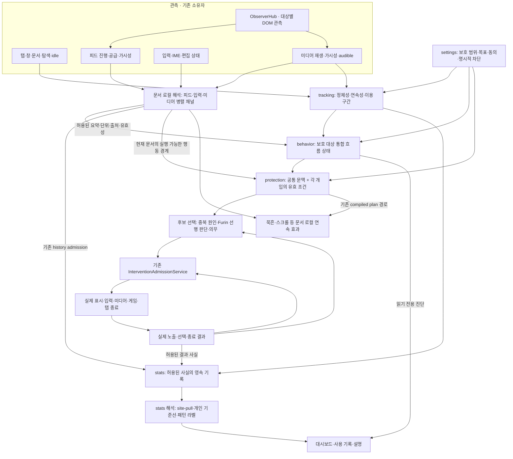
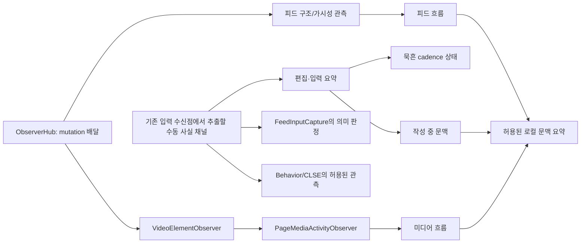
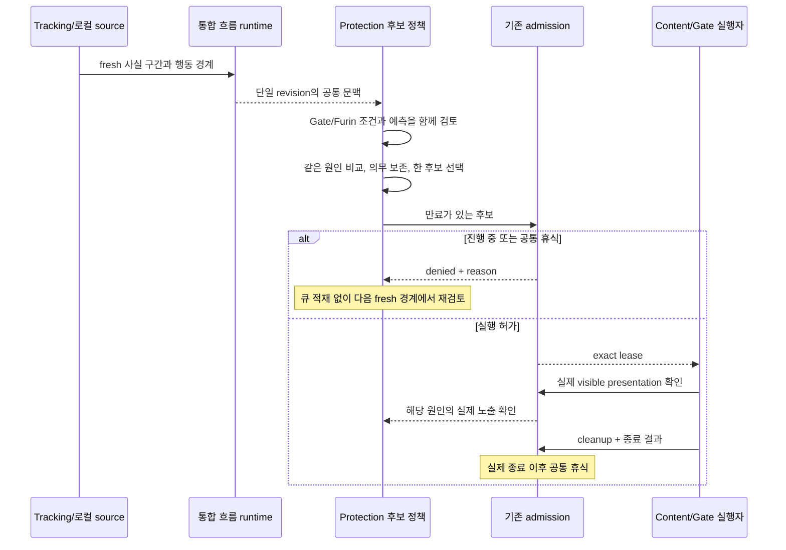
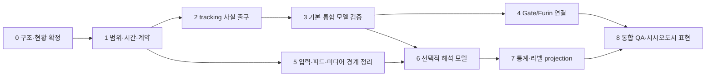

# Protected Consumption Flow Architecture

- Status: Proposed
- Owner: tracking, behavior, protection, nudge, stats, platform storage
- Last validated against code: 2026-09-09
- Path policy: planning-allowed
- Decision needed: Adopt the ownership and contracts below, then implement the foundation and first Gate/Furin integration as separate bounded cutovers before adding optional interpretation channels.

## 1. 목적과 이번 산출물의 범위

보호 대상 전체의 콘텐츠 이용을 하나의 이어지는 흐름으로 설명한다. 탭/문서 관측, 피드, 미디어, 입력, 개입, 통계가 같은 사실을 서로 다른 의미로 다시 계산하지 않게 한다. SSOT는 모든 것을 한 클래스에 넣는다는 뜻이 아니라 **각 사실·상태·결정에 작성자가 하나이며, 소비 경로가 명시되어 있다는 뜻**이다.

이 문서는 구조도와 단계별 구현 계획이다. 2026-09-09에 전경 사용 사실 출구, 보호 대상 간 연속 사용의 세션 체크포인트, Gate 소비 맥락의 읽기 전환을 구현했다. 현재 구현 범위와 제한의 기준은 `docs/architecture/runtime/tracking-consumption-facts.md`다. 아래 전체 소비 엔진·회복·압력·개입 선택 모델은 여전히 제안이며, 그 Active 문서에 명시된 범위 밖의 소유권을 대체하지 않는다. 현재 체크아웃에는 다른 작업의 변경이 있으며, 여기서 확인한 구조는 해당 작업 상태를 포함한다.

용어 정정: 이 작업의 **묵흔은 `inputVisualBrake`의 ‘묵흔의 결계’**다. 입력 간격과 붓의 젖음/마름을 다루는 런타임 효과이며, 대시보드의 시간대별 먹 흔적과 별개다. 두 표현을 같은 데이터 소유자로 취급하지 않는다.

첫 production 범위는 보호 대상 통합 이용/이탈 상태, 시시오도시 단계, Gate/Furin 후보 선택이다. CLSE 기반 개인화, 피드 연구 모델의 승격, 입력 속도에 따른 전역 압력 가산, 패턴 라벨 재설계, 그래픽 변경은 각각 후속 단계다. 자동 개입 안전성은 기존 admission 소유자가 계속 담당한다.

## 2. 목표 구조도

실선은 사실 또는 명시된 파생 값의 전달이다. 이 그림은 목표이며 아직 존재하는 하나의 통합 엔진을 묘사하지 않는다. 관측을 전부 중앙으로 보내는 범용 이벤트 버스는 만들지 않는다.



CLSE는 위 그림의 관측/해석을 제공하는 선택적 하위 시스템이다. CLSE 서비스 자체를 새 최상위 엔진으로 만들지 않는다. 통계의 패턴 라벨도 실시간 정책의 입력으로 되돌리지 않는다. 향후 개인 기준선이 필요하면 승인된 별도 read contract를 추가하고 출처·기준 시점·지원 상태를 명시한다.

화면에서 보이는 하나의 압력은 단일 상태의 요약이다. 같은 압력이라도 피드 진행, 오래 이어진 이용, 재진입은 다른 개입을 필요로 한다. 물리 객체가 위치와 속도를 함께 갖듯 내부에는 원인별 기억과 회복/관측 상태를 유지한다.

## 3. 소유권 배치와 재사용/분리/이동 계획

| 책임 | 현재 확인한 소유자/경로 | 목표와 작업 종류 |
| --- | --- | --- |
| 브라우저 이벤트 등록 | `src/apps/background/services/runtime/backgroundKernelBrowserEventBindings.js` | 유지. app은 등록·주입·조립만 담당 |
| 탐색/전경 연속성 | `src/domains/tracking/background/NavigationContinuityService.js`, `trackingBrowserEventHandlers.js` | 유지·확장. 문서 교체, 같은 탭 탐색, 전경 복귀의 사실을 한 번 판정 |
| 콘텐츠 문서의 실행 준비 | `src/domains/tracking/background/TabContentSessionRegistry.js` | 유지. ready와 visible/foreground/usage를 같은 상태로 합치지 않음 |
| 이용 구간 정산 | `src/domains/tracking/background/TabTimeTracker.js`, `trackingActiveTabRuntimeState.js`, `trackingStatsSettlement.js` | 기존 실제 정산 소유자를 재사용. 통합 모델이 사용 시간을 별도 폴링/재계산하지 않게 좁은 구간 출구 추가 |
| 보호 도메인 판정 | `src/domains/protection/background/protocol/engine/ProtectionScopeResolver.js`, settings/domain rule owners | 유지. 통합 모델은 보호 범위 membership을 계산하지 않고 revision과 함께 전달받음 |
| DOM mutation 배달 | `src/lib/dom/ObserverHub.js` | 유지. 의미 없는 범용 content observer로 확대하지 않음 |
| 미디어 발견/재생 | `src/domains/nudge/video/VideoElementObserver.js`, `src/domains/nudge/media/PageMediaActivityObserver.js` | 유지·필요한 사실 출구 정리. video/audio/shadow root를 다시 스캔하지 않음 |
| 피드 관측/기회/안전 | `src/domains/nudge/feed-flow/FeedObservationRuntime.js`, `capture/FeedInputCapture.js`, `observation/FeedLiveObservation.js`, feed horizon/endpoint owners | 유지. DOM과 지역 기하·기회는 content에 남김. 관측과 판단·actuation 출구를 분리 |
| 일반 입력 관측 | 현재 `FeedInputCapture`, `EditorObservationJournal`, `BehaviorHub`, `inputVisualBrakeManager`에 목적별 접점 존재 | 좁은 수동 관측 채널로 추출 가능성 조사. 동일 이벤트 의미/수명/동의가 증명된 부분만 교체. editor 채널은 최종적으로 feed 하위 소유권에서 분리 |
| 묵흔 상태와 표현 | `src/domains/nudge/inputVisualBrakeManager.js`, `input-visual-brake/InkBrushSession.js`, `InkBrushCanvasRenderer.js` | 유지. 붓의 cadence pressure는 전역 소비 압력과 다른 단위. caret/geometry는 이 소유자만 사용 |
| 문서 로컬 소비 해석 | `src/domains/nudge/attention/dopamineBingeEvidenceRuntime.js`, `RewardDriftObservationRuntime.js`, `consumptionPatternClassifier.js` | 사실/해석/개입 추천을 구분. pressure/추천을 관측으로 역입력하지 않음. 넓은 범위 승격은 별도 cutover |
| 통합 흐름 모델 | 현재 이 문서의 보호 대상 통합 상태에 해당하는 단일 소유자는 없음 | **신규 책임**: `src/domains/behavior/consumption/` 제안. DOM·Chrome·렌더러·라벨·예약 권한 없이 순수 모델과 직렬 runtime 소유자만 배치 |
| Gate/Furin 판단 문맥 | `ProtectionRuntimeInputProvider.js`, `ProtectionRuntimeInputAssembler.js`, Gate state, Furin dispatch owners | 좁은 공통 문맥 입력으로 교체·통합. scope/activation 전용 `ProtectionPolicyEvaluator`를 잡다한 판단 허브로 확대하지 않음 |
| Gate 및 Furin 의무/후보 | `GateInterstitialController.js`, `runtime/GateRuntimeStateOwner.js`, `protocol/dispatch/ProtectionNudgeDispatchRunner.js` | 각 의무의 기존 소유권 유지. 같은 판단 경계의 후보 비교는 protection에 하나의 명명된 순수 정책으로 추가 |
| 실제 실행 권한 | `runtime/InterventionAdmissionService.js`, document arbiter, `runtime/TabClosureArbiter.js` | 유지. 새로운 scheduler, lease, cooldown 권위 금지 |
| 통계/패턴 | `statsCollector`, typed stats repositories, `src/domains/stats/insights/sitePull/` | 사실 저장과 해석 분리 유지. policy 점수는 관측 사실을 대체하지 않음 |
| 영속 저장 | `src/platform/storage/` typed repositories | 기존 backend 경계 재사용. 새 데이터 종류에는 먼저 exact typed contract와 reset/retention 정책 추가 |

`src/apps/background/services/runtime/ProtectionRuntimeStateCoordinator.js`는 기존 delegation/snapshot 경계다. 여기에 새 모델 상태나 모든 탭의 흐름 상태를 몰아넣지 않는다. 통합 모델은 Gate 내부에도 두지 않는다. Gate 이외의 소비자가 생겼을 때 다시 이관할 책임이기 때문이다.

새 디렉터리의 최소 형태는 다음과 같다. 파일명은 구현 전 계약 확정 단계에서 고정한다.

```text
src/domains/behavior/consumption/                 # proposed
  contracts/                                    # 관측 요약·모델 state·읽기 DTO
  model/                                        # 순수 상태 전이·요약·이유 projection
  runtime/ProtectedConsumptionRuntime.js         # 단일 writer, 적용 cursor, persist
  public.js                                     # typed read/ingress ports만 공개
src/domains/nudge/observation/                    # proposed narrow content seam
  editor/                                       # feed와 독립된 editor 관측
src/domains/protection/background/policy/         # existing directory
  ...                                           # 공통 문맥 기반 후보 비교 정책
```

## 4. 옵저버와 입력을 어떻게 배선할 것인가



공통 입력 채널은 첫 단계부터 모든 pointer/key 이벤트를 수집하는 새 listener가 아니다. 기존 listener inventory 후, 동등한 목적의 passive acquisition을 한 소유자로 옮기는 경우에만 만든다. `preventDefault`, 입력 지연, game input, pointer capture는 각 actuator의 동기 실행 권한으로 남는다.

**병합 기준**은 관측 대상·이벤트 의미·실행 시점·동의/기능 수요·수명·출력이 모두 일치하는가다. 같은 노드나 같은 프레임을 본다는 이유만으로 중복이라 판단하지 않는다. `ObserverHub`의 mutation 공유, media registry 공유, 기하 측정 공유는 별도 수준이다. selector의 의미와 endpoint 안전 판정은 각 owner에 남는다.

입력 채널은 글자·단어·키 내용·클립보드·DOM path를 보내지 않는다. 허용 범위는 기능별로 승인된 입력 발생, IME 조합 상태, 편집 focus/availability, 간격·구간 요약이다. 민감 필드의 제외/추상화 계약을 묵흔에서 새 채널로 완화하지 않는다. 현재 묵흔의 일시적인 caret 측정용 값 접근은 전역 입력 수집 권한이 아니다.

작성 활동은 소비를 과대 판단하지 않기 위한 문맥으로 먼저 사용한다. 빠른 타이핑을 전역 위험/인지부하 가산으로 바로 연결하지 않는다. 작성 중이라는 이유만으로 보호 사이트 이용 기록을 지우거나 휴식으로 확정하지도 않는다.

first subscribe / last unsubscribe, 문서 교체, BFCache, visibility, IME 종료, feature disable, permission revoke를 수명 계약에 포함한다. CLSE만 필요로 하는 관측은 CLSE가 꺼졌을 때 유지하지 않는다. 로컬 피드/묵흔 실행이 무거운 CLSE 모듈 로딩을 요구해서는 안 된다.

## 5. 범위와 시간의 공통 계약

### 정체성은 계층별로 유지

| 범위 | 기준 | 바뀔 때의 의미 |
| --- | --- | --- |
| Profile/runtime generation | 기존 profile mutation gate와 boot lifetime | reset/import/permission 변경 전의 응답이 새 상태를 변경할 수 없음 |
| Tab | 브라우저가 부여한 실제 tab id | 탭 객체의 수명. 탭 생성은 실제 소비가 아님 |
| Document/frame | sender에서 확인한 document/frame identity | 새 문서는 새 local producer. SPA 경로 변경과 구별 |
| Domain/protected set | canonical domain match + 설정 revision + 적용 구간 | 사이트 소속과 정책의 범위. 콘텐츠가 임의 host를 선언할 수 없음 |
| Local observation epoch | producer lifetime, sequence, observation clock | geometry/coverage 단절. 전역 이용 구간을 자동 초기화하지 않음 |
| Protected-use episode | tracking 사실을 소비한 통합 모델의 이용/회복 상태 | 여러 보호 도메인과 탭을 가로지름. 하루 경계·설정 재적용·renderer remount와 별개 |
| Intervention | 기존 candidate/lease/run/Gate session ids | 노출·종료·의무 처리의 정확한 귀속. 이용 episode와 다른 개념 |

브라우저의 tab active, window focus, document visible, dispatch ready, media playing은 별도 사실이다. 한 필드를 나머지 의미로 재사용하지 않는다. 창이 여럿이어도 전경 사용은 실제 관측한 범위만 인정한다. 미디어와 전경의 통합 이용은 시간 구간의 합집합으로 계산하며, 도메인별 귀속과 브라우저 전체 합계를 구별한다.

### 최소 전달 계약

모든 채널을 똑같은 거대 DTO로 만들지 않는다. 다음 의미를 공유하고, payload는 discriminated union/정확한 runtime validator로 채널별 검증한다. 저장소 전체 TypeScript 전환은 이 작업의 선행 조건이 아니다.

| 계약 | 필수 의미 |
| --- | --- |
| `ObservationSlice` | kind/version, producer/epoch, sequence 또는 구간 id, 신뢰된 scope, 시간 구간, 단위, lineage, observation availability, purpose admission, payload |
| `ConsumptionContext` | model version/revision, evaluatedAt, 사용한 source revision/coverage, 보호 이용 기억, 반복 요구 기억, 확인된 이탈/회복 상태, 원인·추세 projection |
| `InterventionCandidate` | 기존 후보 계약 + 필요한 context revision, 정확한 cause/obligation 참조, 근거의 기한, source action boundary, 표시 예상 시간/도래 예측의 유효성 |
| `InterventionOutcome` | 기존 lease/run/session, 실제 shown/ended/choice, exact scope, generation, 결과 중복 방지 identity |

host, top frame, document는 메시지의 자기 신고보다 기존 trusted sender 경계가 우선한다. 관측 payload가 탭 선택·탭 닫기·Gate session 권한을 부여할 수 없다.

### 시간과 동기화

- 문서 안의 경과 시간은 기존 monotonic clock을 쓴다. 다른 문서의 `performance.now()`를 직접 비교하지 않는다. background 입구에서 발생 구간과 수신 시점을 보존하고, 정렬 가능한 근거가 없으면 시간 불확실성을 명시한다.
- global runtime writer는 기존 이벤트/메시지 진입 경계를 통해 직렬 적용한다. 전체 브라우저의 완전한 동시 시점을 가정하거나 모든 탭의 응답을 기다리는 barrier를 만들지 않는다. 읽기 DTO는 as-of revision과 source별 freshness를 가진다.
- producer별 순서·cursor로 중복 적용을 막는다. 지연·역순·누락은 명시적으로 reject/partial 처리한다. 누적 snapshot의 delta를 정확한 시점의 개별 사건으로 꾸미지 않는다.
- 모델 읽기는 상태/회복/관측 시계를 변경하지 않는다. 같은 증거를 읽는 빈도에 따라 압력이 달라져서는 안 된다.
- 시간 경과 projection과 commit은 기존 입력/탐색/미디어/공유 heartbeat 경계를 이용한다. 새 영구 `setInterval`, 개별 deadline alarm, 백그라운드 animation loop는 만들지 않는다.
- 새 필수 시간 source가 필요한 것으로 드러나면 `AlarmScheduler`의 기존 계약에서 역할을 추가하고 비용을 검증한다. effect나 모델이 몰래 등록하지 않는다.
- 보고가 없다는 것, hidden, unsupported, permission denied, 관측 단절, 명시적으로 관측한 이탈은 서로 다른 상태다. 감쇠는 기억의 변화이며 휴식 증명이 아니다.
- 시스템 시각 이동/절전/worker 재시작은 음수 duration이나 즉시 회복을 만들지 않도록 named discontinuity로 처리한다. 관측할 수 없는 다른 브라우저/기기 이용을 추정하지 않는다.

## 6. 통합 상태와 정책의 경계

첫 모델은 기능을 식별하는 원시 이벤트를 무한히 저장하지 않고, 원인별 bounded memory와 적용 cursor를 가진다. 권장 최소 상태는 통합 이용 기억, 반복 요구 기억, 회복 상태다. 대표 압력·추세·단계·reason은 한 순수 projection이 계산한다. UI, Gate, stats가 공식을 복제하지 않는다.

정확한 누적 함수·감쇠·짧은 진입 처리·hold 단계는 아직 미확정이다. 앞선 논의의 10분/15초/0·4·8·12초는 제안값이지 채택된 계약이 아니다. 먼저 불변조건을 정한 다음 비교한다. 새 모델 점수의 크기는 인지부하 확률이나 임상적 척도가 아니다.

핵심 불변조건:

1. 같은 물리적 사실을 여러 채널이 설명해도 별도 독립 증거처럼 중복 가산하지 않는다. lineage 정책이 한 가지 의미를 선택하거나 명시된 파생 관계로 유지한다.
2. protected A → B 이동은 회복이 아니다. 문서/탭/설정 재적용으로 global state가 초기화되지 않는다.
3. 짧은 진입 하나의 영향은 제한되고, 반복된 짧은 진입은 기억된다. 단순 navigation 신호와 실제 이용을 구별한다.
4. optional channel이 없다고 0을 대입하거나 나머지 weight를 몰래 재정규화하지 않는다. 기본 모델과 선택적 근거의 지원 상태를 명시한다.
5. 전경 이용과 미디어가 겹치는 시간은 중복 사용량이 아니다. 작성/정적 읽기/소비 의도를 입력 횟수 하나로 판정하지 않는다.
6. threshold 주변에서 상태가 떨리지 않도록 진입/해제 조건을 분리한다. 한번 시작한 ritual의 약속된 대기 시간은 도중에 늘리지 않는다.
7. 개입 자체의 입력·대기·스크롤 보정은 페이지 소비 근거와 분리한다. 개입 성공이 압력을 자동으로 0으로 만들지 않는다.

각 source 정책은 자기의 현재 실행 조건을 계속 확인한다. Global Furin의 실제 목표/의무, Site Furin의 해당 사이트 조건, Enso의 endpoint/renewed-demand, 묵흔의 editable target 조건을 대표 압력 하나로 대체하지 않는다.

연속 효과와 discrete 개입을 구분한다. 묵흔·스크롤 물리·기존 필터는 compiled plan과 local input 경로를 사용한다. 매 입력/프레임에 background admission 왕복을 하지 않는다. 전역 modulation은 이후 별도 feature contract로 도입하고, local physics state와 global pressure를 같은 값으로 쓰지 않는다.

## 7. 후보 생성·우선 선택·실행의 배선



후보를 비교하는 순수 정책은 기존 protection 평가/dispatch 경계에 연결한다. admission은 이 정책을 위한 두 번째 모델이나 후보 큐를 소유하지 않는다. background 전체 판단은 하나의 scoped evaluation context를 전달하되, async local source 증거의 만료를 숨기지 않는다.

- **시시오도시와 임박한 Furin**: Gate의 예상 점유 시간 + 실제 종료 후 공통 간격이 유효한 Furin 도래 구간을 침범하면 Gate 후보를 생략할 수 있다. 예측은 Furin 소유자가 제공한다. 모든 source에 임의의 ‘n분 이내 가능성’을 만들지 않는다.
- **예측과 실행**: Gate 생략은 Gate shown/의무 완료가 아니다. Furin 조건이 사라지면 stale intent를 취소한다. 생략 기록은 원인별 bounded state이며 무한 면제나 밀린 Gate 자동 재생을 만들지 않는다.
- **Site/Global**: 같은 cause의 중복 체험은 실제 노출 확인 뒤에만 기존 generation/CAS 경계에서 흡수한다. distinct obligation을 숫자 우선순위로 지우지 않는다.
- **가지치기**: 알림/검토/실제 탭 정리 의무를 분리한 기존 구조를 확장한다. Furin 표시만으로 정리 의무를 해소하지 않는다. 새 진입 제한과 현재 화면 선점은 다른 정책이며, ‘항상 정리’가 모든 Gate의 선점 예외를 의미하지 않는다.
- **의무 차단**: 현재 명시적 isolation 예외를 유지한다. 새로운 즉시 차단 유형은 별도 capability/cleanup/탭 권한 계약 없이는 추가하지 않는다.
- **수동 QA**: 자동 조건을 우회할 수 있어도 production/manual 활성 소유권을 빼앗지 않는다. 자동 흐름은 manual Furin을 재시작하지 않는다.
- **실패/노출**: 예약 실패·표시 전 취소는 노출·쿨다운·의무 처리를 소비하지 않는다. 실제 사용자 선택은 관측 결과로 기록할 수 있지만, ‘개입하기로 결정함’은 사용자 행동 사실이 아니다.

45초 공통 간격, 5초 후보 유효기간, 10초 예약 수명은 현재 [admission 계약](intervention-admission-runtime.md)을 따른다. 후보 선택 모델이 이 값을 복제하거나 우회하지 않는다. 더 긴 source별 재노출 정책과 압력의 회복은 서로 다른 목적이므로 함께 존재할 수 있으며, 각 소유자를 명시한다.

## 8. 저장·동의·재시작 계약

| 데이터 종류 | 작성자와 저장 | 주의점 |
| --- | --- | --- |
| DOM/input/media 원시 대상, caret, local event journal | 기존 content owner의 bounded memory | 원문·DOM·selector·키 내용을 전송/영속화하지 않음 |
| 탭/문서/관측 producer의 진행 상태 | 기존 typed `chrome.storage.session` runtime repositories | 모델의 durable pressure를 session mirror로 다시 소유하지 않음 |
| 새 통합 모델의 브라우저 재시작 간 기억 | behavior writer → **제안하는 typed model checkpoint** → 기존 IndexedDB `model_state` 경계 | compact model state와 applied source cursor를 같은 transaction/CAS로 commit. 정책 version과 retention/reset 계약 필요 |
| 실행 예약/노출/공통 휴식 | 기존 `InterventionAdmissionRepository`의 session 계약 | 이번 구조 문서가 browser-session 보호를 durable 보호로 이미 확장했다고 주장하지 않음 |
| 사용/선택/허용된 입력 요약 등 역사적 사실 | stats writer → 기존 typed stats/history stores | 모델 score를 관측 사실 칸에 넣지 않음. 별도 목적 admission 유지 |
| CLSE buckets/baseline | 기존 CLSE repositories | 꺼진 CLSE나 동의 없는 history를 통합의 전제 조건으로 삼지 않음 |
| 패턴 label/현재 압력/대시보드 projection | 각각의 read/model owner | 독립된 canonical snapshot으로 중복 저장하지 않음 |

영속 모델은 신규 데이터 종류다. 기능 수행에 필요한 최소 기억과 분석/개인화를 위한 기록의 경계를 `dataCollectionPolicy` 및 storage Active 문서에 먼저 명시해야 한다. 보호 사이트 등록이나 host permission으로 precision/입력 history 동의를 추정하지 않는다. 동의 없는 모드의 기능상 허용된 최소 state 범위도 명시적으로 승인된 계약이어야 한다.

두 소비자(stats/model)가 같은 source 사실을 받더라도 목적 admission과 durable ACK는 별개다. 모델 ACK로 history 저장 성공을 주장하지 않는다. 기존 feed history receipt/reset fence를 보존하고, model cursor와 stats receipt를 합쳐 의미 없는 글로벌 ACK를 만들지 않는다.

지속 모델은 이벤트 경계와 기존 heartbeat에서 bounded commit한다. admission에 사용되는 상태는 해당 경계까지 commit이 확인되어야 한다. 메모리 draft는 진단으로 구별한다. worker/browser 소실 시 아직 commit하지 못한 구간의 손실 한도를 명시하고, 누락된 입력을 0이나 휴식으로 채우지 않는다. 원시 사실 전체의 영속 event log는 기본 제안에 포함하지 않는다.

restart에서 model checkpoint는 유일한 기억의 출발점이고 session state는 실행 중 identity만 복구한다. 두 모델 사본을 비교해서 더 최신처럼 보이는 것을 선택하는 fallback은 금지한다. 관측 불가 기간은 모델 age와 observation gap으로 표현한다. 설정 재적용은 재초기화하지 않으며, scope가 실제 변경되면 이전 membership 구간을 닫고 새 revision으로 계속한다. 과거 이용을 새 membership으로 소급 재분류하지 않는다.

profile reset/import, analytics 삭제, precision consent revoke, 기능 disable, 모델 버전 전환, 브라우저 종료는 서로 다른 lifecycle이다. 각각 어떤 state를 유지/정지/삭제하는지 단계 1에서 표로 확정한다. browser close/reopen만으로 무료 첫 진입이 재발급되는 모델은 첫 production 완료 조건을 충족하지 못한다.

## 9. 통계와 패턴 라벨의 배선

통계는 global runtime의 모든 내부 state를 그대로 저장하는 통이 아니다. source별 허용된 사실을 기존 writer/receipt 경계로 기록하고, 모델 출력은 필요한 경우에만 version과 의미를 갖춘 별도 진단/결과 종류로 다룬다.

라벨링은 세 층을 구분한다.

| 층 | 예 | 권한 |
| --- | --- | --- |
| 관측 상태 | writing, media active, feed supported, hidden | 해당 source가 확인한 사실/coverage |
| 실시간 모델 해석 | 반복 요구가 최근 증가, 보호 이용이 이어짐 | 모델 문맥과 candidate reason. 인지 상태나 장기 습관을 확정하지 않음 |
| 역사적 패턴 | site-pull의 checking/immersion 및 기준선 해석 | stats evidence/requirements/calibration을 거친 설명. runtime activation 입력으로 역류하지 않음 |

`consumptionPatternClassifier`에는 현재 패턴과 개입 추천 vocabulary가 함께 있다. 새 공통 모델을 붙이기 전에 measurement, descriptive interpretation, policy recommendation의 실제 호출자를 추적하고 분리 여부를 결정한다. 함수 이름 변경만으로 분리됐다고 보고하지 않는다.

Site-pull의 `feed_progression` lineage와 calibration/requirements를 유지한다. feed 공급·scroll velocity·진행량의 여러 projection을 독립 corroboration으로 세지 않는다. 모델이 개입을 선택했다는 사실로 다시 ‘문제적 패턴’의 증거를 강화하지 않는다. 실제 continue/leave/재진입 결과는 기존 outcome evidence family로 별도 귀속한다.

## 10. 단계별 실행 계획

각 단계는 독립적으로 검토할 수 있는 change set이다. 전체 목표 구조를 먼저 채택하되, 모든 파일 이동과 모든 모델 변경을 한 번에 묶지 않는다. 한 책임의 소유권을 실제로 바꾸는 단계에서는 해당 책임의 writer와 소비자를 함께 전환하고 구 경로를 제거한다. shadow 비교는 읽기/진단 전용이며, 두 production 모델이나 fallback authority를 병렬로 유지하는 수단이 아니다.



도표의 병렬선은 설계상 의존관계이며 다중 에이전트 실행 지시가 아니다. 단계 4의 기본 기능은 단계 5~7의 전체 완료를 기다리지 않는다. 단계 5~7이 미완료일 때는 ‘기본 Gate/Furin 통합’이라고 보고하고 앱 전체 모든 채널의 통합 완료라고 부르지 않는다.

### 단계 0 — 현황과 구조 결정

- **작업**: 이 구조도, 실제 owner map, 묵흔 용어 정정, 책임별 유지/추출/교체 목록을 검토한다. 실제 listener/observer/clock/store/DTO consumer 목록을 추출해 관측→결정→실행의 선을 확인한다.
- **필수 산출물**: 각 subscription의 event/root/cadence/demand/teardown/output/consumer 표, 각 state의 writer/store/reset 표, 기존 pressure라는 이름의 단위/목적 표, 현재 import/call graph에서 중복 authority 후보 목록.
- **범위**: 코드 이동·개입 정책 변경 없음. 이 문서는 첫 구조 초안이며 listener 전수조사는 후속 구현의 시작 작업으로 남긴다.
- **완료 조건**: 탭/도메인/문서/episode 구별, 보호 범위, facts/model/policy/actuation/history의 writer가 모두 지정되어 있고 신규 모듈을 두는 이유가 기존 소유자와 중복되지 않음.

### 단계 1 — 공통 정체성·시간·purpose 계약 고정

- **선행**: 단계 0.
- **작업**: source identity/epoch/sequence, 단위, 시각의 의미, availability, source lineage, settings/profile revision의 최소 공통 vocabulary 정의. 과도하게 모든 채널의 모양을 통일하지 않는다.
- **수정 경계**: tracking/public observation 출구, behavior consumption contract, protection input context, messaging validators, typed model checkpoint 계약. `SettingsService`와 profile mutation gate의 현재 진입 권한을 재사용한다.
- **정할 항목**: protected membership 변경 구간, idle/잠금/절전/재생의 관계, analytics 동의와 기능상 상태, restart/import/삭제 각각의 state 정책, model version 변경 방식.
- **검증**: malformed/unknown payload, source epoch 혼용, stale setting generation, out-of-order/duplicate, null과 observed zero, 단위 불일치, scope spoof 거절. schema와 validator의 중복 정의 없이 한 public exit를 확인한다.
- **완료 조건**: 각 계약에 producer·consumer·시계·수명·오류·적용 순서가 문서화됨. 행동은 기존과 동일하며 아직 압력으로 intervention을 변경하지 않음.

### 단계 2 — tracking 사실을 보호 대상 전체에서 연결

- **현재 구현**: 전경 사용 사실/세션 체크포인트에 이어, 기존 Tracking 배치의 탭 목록·실제 창 포커스·보호 탭 audible 시점 관측을 공통 읽기 문맥에 연결했다. `behavior/consumption/consumptionContext.js`는 같은 사실에서 읽기 전용 설명을 만든다. 배경 미디어의 연속 시간 합집합, 회복 계산과 브라우저 재실행 후 지속 모델까지 완료된 것은 아니다. 현재 계약은 `tracking-consumption-facts.md`를 따른다.
- **선행**: 단계 1.
- **작업**: 기존 tracking 정산에서 전경 사용/이탈 구간을 읽는 좁은 출구를 만들고, media 상태와 합집합을 구성할 실제 소유자를 확정한다. 새 tab registry, 새 hostname matcher, 새 사용시간 타이머는 만들지 않는다.
- **수정 경계**: `trackingBrowserEventHandlers`, navigation continuity, active tab/settlement, scope projection, media evidence transport, background composition. DOM feed/input 관측은 이 단계에 포함하지 않음.
- **검증**: A→B→A, 동일 host 다른 탭, 두 창, 미리 연 inactive 탭, SPA/BFCache, audible background, 문서 소실, suspend/resume, duplicate delivery, scope 변경 시 소급 합산 금지.
- **완료 조건**: 보호 A/B 이동이 휴식으로 분류되지 않고, 하나의 시간 구간이 다중 탭/미디어에서 중복되지 않음. 기존 통계 정산과 projection의 차이가 설명 가능하며 모델이 통계를 다시 추정하지 않음.

### 단계 3 — 작은 통합 흐름 모델과 영속 경계

- **현재 live 연결 범위**: `consumption-memory-runtime.md`에 기존 Tracking 배치·브라우저 ingress fence·제한된 audible 구간·admission 노출을 결합하는 단일 모델 writer와 typed IndexedDB state/cursor CAS를 구현했다. 공통 context의 warm memory read에서 첫 live 소비자로 Zen 진입 Gate의 넘침 강도만 연결했다. 자격·통행권·Furin 타이밍은 기존 정책을 유지한다. 아래 오프라인 평가 기록은 해당 평가기의 한계다. live 관측에도 확정 outside 생산자는 없으며, 현재 범위·확정 지연·불확실성·세션 강도 고정은 `consumption-memory-runtime.md`를 따른다. 앱 전체 소비 엔진과 회복·전환 패턴 개입은 여전히 남아 있다.

- **실제 노출 관측 연결**: admission의 동일 session commit에 제한된 노출 구간을 기록하고, runtime input에서 마지막 Tracking receipt와 교차해 미점유·표시·불확실 시간을 구분한다. 진행 중/종료 미확인 구간을 확정 사용으로 소비하지 않는다. 이어서 live 모델의 영속 cursor와 관측 결합을 추가했으며, 원래 stats 합계와 재노출 자격은 바꾸지 않는다.
- **관측·개입 연계 평가 보강**: 같은 평가 계약에 실제 collection/Tracking 입력 shape, Gate assembler·통행권·admission service를 사용하는 오프라인 여정 재생을 추가했다. 관측 공백을 unknown으로 유지하고 고정/적응 대기를 비교한다. 실제 stats ACK·미디어/노출 구간 생산자·모델 영속 상태·production hold 전환은 아직 구현 범위 밖이다. 합성 비교에서 대기 증가와 짧은 진입 취소 뒤 재노출 증가가 확인되어, 통과율만으로 적응형 대기를 승격하지 않는다.
- **2026-09-09 평가 구현**: `consumption-memory-model-evaluation.md`에 순수 이용 기억 모델, 시시오도시 수준 후보 함수, 재현 가능한 semi-Markov 패턴 생성기와 불변조건 평가를 구현했다. production 통합 상태는 여전히 미완료다. 시점 관측으로 이탈 구간을 꾸미거나 브라우저 재실행 때 새 0을 부여하지 않도록, 관측 결합과 영속 계약을 먼저 확정한 뒤 기존 hold 소유자를 교체한다.
- **전환 패턴 확장 경계**: 별도 관측기를 만들지 않고 Navigation의 실제 전환을 사용 사실의 lineage와 결합하는 behavior 해석 모듈로 둔다. 같은 도메인 내 탭 이동/보호 도메인 간 이동/보호 밖 이탈을 구분하며, heartbeat·설정·자정에 의한 구간 분할을 전환 횟수로 세지 않는다. 현 단계는 `switching: not_evaluated`만 명시하고 가중치·압력 가산·개입 변경은 구현하지 않는다.
- **선행**: 단계 2.
- **작업**: `behavior/consumption`의 순수 상태 전이, 단일 writer, typed checkpoint, read-only explanation을 구현한다. 첫 입력은 단계 2의 기본 사실과 유효한 재진입 근거로 한정한다. CLSE/피드 연구 점수는 사용하지 않는다.
- **모델 비교**: 지속 이용, 잦은 짧은 복귀, 긴 이탈, 짧은 오진입, 관측 공백에 대해 소수의 누적/회복 후보를 비교한다. 관측된 이탈과 단순 memory decay를 분리한다. hold 값보다 모델 불변조건을 먼저 고정한다.
- **영속성**: 상태와 적용 cursor의 원자 commit, version/epoch, worker restart, browser reopen, reset/import에 대한 정확한 행동을 구현한다. 정책에서 사용할 checkpoint commit 실패는 명시적으로 거절한다.
- **검증**: 동일 timeline의 다른 샘플 빈도/배치 분할에서 허용 오차 내 동일 결과, 반복 read 무효과, 포화/회복 경계, 작은 입력의 제한된 영향, unknown 상태, 누락 범위 이후 complete로 위장하지 않음. 기대값은 구현식 복사로 만들지 않는다.
- **완료 조건**: pressure 값의 변화 이유를 실제 사실 구간으로 설명 가능하고, frozen corpus와 나중에 공개하는 challenge 사례에서 경계를 지킴. 합성 PASS를 실제 사용자 의도 분류 정확도로 주장하지 않음. 아직 production 개입 선택 권한은 기존 정책에 있음.

### 단계 4 — 첫 production 경로: 시시오도시와 Furin

- **선행**: 단계 3의 모델/저장 검증.
- **작업**: 통합 문맥을 Gate 단계와 Gate/Furin 후보 비교에 연결한다. 허가 전에 같은 평가 경계의 후보를 비교하고, 첫 번째 도착한 요청의 우연한 순서만으로 선택되지 않게 한다. 기존 Furin 목표/의무·실제 도래 근거는 유지한다.
- **소유권 전환**: Gate의 도메인별 회복/강도에 해당하는 중복 계산을 명시적으로 교체한다. 단순히 새 global check 위에 예전 모든 조건을 AND로 얹지 않는다. 남기는 source pass, explicit-return, obligation마다 독립 목적을 문서화한다.
- **정책**: 충분한 회복의 첫 진입 생략, 단계와 재노출 자격 분리, 약속된 hold 유지, 임박한 Furin을 위한 Gate 생략, 예측 실패 재검토, 가지치기 실제 의무 유지. 수동 QA와 isolation 예외는 기존 계약 유지.
- **검증**: Gate/Furin 동시 후보, Site/Global 동일/다른 cause, candidate cancel/failure, 예약 후 navigation, stale closure, mandatory cleanup, setting disable 중 in-flight, manual collision, 공통 45초 및 더 긴 source 정책 보존.
- **완료 조건**: 기본 dev/public에서 이 경로가 단일 모델/context/admission을 사용. named browser QA의 여러 탭 실제 lifecycle 증거 확보. 미검증 browser run은 별도로 남김.
- **첫 출시 가능한 범위**: tracking 기반 통합 흐름 + Gate/Furin 선택. feed/input/CLSE를 모두 통합했다는 주장 금지.

### 단계 5 — 입력·피드·미디어 관측 경계 정리

- **선행**: 단계 1과 단계 0의 listener inventory. 단계 4 완료 전에도 구조 작업을 따로 수행할 수 있으나 동시 같은 writer 수정은 피한다.
- **작업 5a 입력**: `EditorObservationChannel`의 feed 소유권을 독립 content observation으로 옮길 최소 단위를 정한다. FeedInputCapture, 묵흔, Behavior/CLSE consumer의 동일 acquisition만 통합한다. IME/caret/동기 input 차단은 소유자의 기존 의미를 보존한다.
- **작업 5b 피드/미디어**: 기존 `ObserverHub`/video/media registry를 재사용하며 content-free summary 출구를 정리한다. endpoint 판단에 필요한 DOM은 local에 남는다. 로컬 journal과 background summary의 손실/TTL 경계를 명시한다.
- **작업 5c 비용**: root scan, attribute interest, callback/geometry cost, mutation burst, hidden teardown, live consumer 수를 측정한다. 같은 대상 관측이라는 이유만으로 병합하지 않는다.
- **검증**: 묵흔 off + editor 관측 on, 반대 조합, CLSE off, precision consent revoke, IME/paste/sensitive field, 작성 중 피드 이동, programmatic scroll/anchor correction, audio-only/open-shadow, nested scroller, unsupported surface.
- **완료 조건**: 목적과 출력이 같은 duplicate acquisition은 제거되고, 합치지 않은 observer는 이유가 기록됨. 새 background/global scan 없음. feed가 없는 페이지에서도 입력 채널이 성립하며 묵흔 물리가 변화하지 않음.

### 단계 6 — 피드/입력/CLSE의 선택적 해석 연결

- **선행**: 단계 3, 5.
- **작업**: 원시 사실을 모델 계약에 맞추는 channel adapter를 추가하고 원인별 변화를 독립 비교한다. 기존 연구 전용 feed pressure·temporal interpretation·editor 채널의 승격 여부는 각각 검증한다.
- **순서**: 먼저 관측 사실과 coverage만 연결 → context 보호/설명에 사용 → 개선 증거가 있는 요소만 pressure projection에 반영. typing cadence는 writing context로 시작하고 소비 압력 가산은 별도 모델 결정으로 남긴다.
- **CLSE**: optional descriptive contribution과 개인 기준선 권한을 분리한다. 모델 기본 동작에 CLSE enable/학습 완료가 필요하지 않음. 관측 세기와 데이터 신뢰도를 같은 숫자로 합치지 않음.
- **검증**: feed+CLSE 같은 scroll lineage 중복, media+foreground overlap, writing 오분류, short-form/continuous/unsupported 채널 차이, sparse baseline, blind/held-out 시나리오, coverage loss, 실제 관측과 oracle의 독립성.
- **완료 조건**: 각 추가 신호가 어떤 기존 판단을 개선하는지 설명되고 새 오류 유형/비용이 허용됨. 도움이 입증되지 않은 채널은 production 입력으로 추가하지 않음. 연구 코드를 새 scheduler의 숨은 fallback으로 사용하지 않음.

### 단계 7 — 통계·패턴 라벨·사용자 설명 정렬

- **선행**: 단계 1의 역사/기능 목적 계약, 단계 6에서 실제 채택한 신호. 기본 단계 4의 사실/결과 저장 검증은 이미 끝나 있어야 한다.
- **작업**: approved observations를 기존 stats writer에 연결하고 site-pull facts/lineage/requirements/calibration을 맞춘다. runtime pressure, 입력 붓 pressure, site-pull 점수, 하루 표시 pressure를 동일 숫자로 바꾸지 않는다.
- **사용자 설명**: 최근 보호 대상 전체 이용과 해당 사이트의 마지막 세션을 구별한다. 선택한 한 줄의 설명은 결정 당시 revision의 실제 근거에 연결한다. 테마가 이유나 통계를 재계산하지 않음.
- **검증**: 사용/노출의 단위와 attribution, receipts/idempotency, history opt-out, partial coverage, reset fence, wrong-domain stale projection, label source independence, UI readiness와 observed zero.
- **완료 조건**: 대시보드와 런타임 설명이 같은 사실을 사용하고 다른 시간/목적의 projection 차이는 명시됨. 기존 pattern label을 통한 실시간 개입 역류가 없음.

### 단계 8 — 통합 lifecycle QA와 시시오도시 표현 개선

- **선행**: 기능별 검증이 끝난 경로만 포함. 단계 4 이후 기본 범위 QA를 먼저 할 수 있다. 확장 채널까지 포함한 완료 보고는 단계 5~7 완료 뒤에만 한다.
- **통합 QA**: 아래 matrix와 named QA target의 필요한 확장을 구현한다. default dev와 public capability 차이를 검증한다. 단위/합성/실제 브라우저/인간 체험 결과를 별도로 기록한다.
- **시시오도시 표현**: 정책과 별도 change set으로 물 재질, 실제 impact 좌표, portrait scene scale, 한 줄 문맥, first-entry 무개입, bounded hold, reduced motion/keyboard/IME를 다룬다. 모델을 renderer에 넣지 않는다.
- **유지 사항**: Furin 게임 연출과 HUD 기본 off, manual 격리, renderer/media/input cleanup을 보존한다. pressure 모델 통합을 이유로 이미 진행 중인 게임을 재설계하지 않는다.
- **완료 조건**: 검증된 범위만 Active 문서에 반영하고 구 writer/path/계약을 제거한다. 남은 optional 채널과 플랫폼 관측 한계를 명시한다.

## 11. 한 번에 다룰 범위와 전환 규칙

권장 작업 묶음은 다음과 같다. 각 묶음 안에서도 변경이 커지면 사실 계약과 소비자 cutover를 분리해 검토할 수 있지만, 같은 책임의 두 writer를 활성화한 상태로 끝내지 않는다.

| 묶음 | 포함 | 제외 |
| --- | --- | --- |
| A 구조 기반 | 단계 0~1, ownership/contract/새 저장 종류 결정 | 압력 가중치·UI·효과 변경 |
| B 첫 통합 구현 | 단계 2~4, 필요한 기본 stats/outcome 경계, 기본 named QA | editor 대이동, CLSE 개인화, feed 연구 모델 승격 |
| C 관측 정리 | 단계 5, proven duplicate acquisition 제거 | 후보 policy 변경과 한 diff에 혼합 |
| D 해석/표현 확장 | 단계 6~7, 채택된 channel별 한 번에 하나 | 모든 점수 동시 합산/기존 라벨의 무검증 재활용 |
| E 시시오도시 그래픽 | 단계 8의 표현 변경, portrait/interaction QA | Furin 게임/HUD 정책 변경 |

전환마다 (1) old/new 책임 대응표, (2) 새 public exit, (3) 모든 소비자 교체, (4) old writer/경로 삭제, (5) Active doc/guard 갱신, (6) rollback/저장 version 호환성을 포함한다. 실패 시 같은 change set을 되돌리거나 명시적 지원 불가로 남긴다. 새 입력이 없을 때 예전 detector를 몰래 실행하는 자동 fallback을 만들지 않는다. 저장 변경은 데이터 삭제를 rollback 수단으로 삼지 않는다.

새 공통 모델을 만들었다는 이유로 `BackgroundAppKernel`, `BehaviorHub`, `ObserverHub`, `ProtectionController`를 거대 엔진으로 확대하지 않는다. app 조립, 관측 배달, business state, actuator 수명은 각각의 소유자에 남는다.

## 12. 검증 matrix와 정식 QA 계획

| 시나리오 | 확인할 불변조건 | 필요한 증거 |
| --- | --- | --- |
| A 오래 이용 → B 오래 이용 → A | 통합 누적 유지, A 이탈을 회복으로 오인하지 않음 | tracking/model replay + multi-tab browser |
| 다수 탭/두 창/빠른 왕복 | 중복 시간 없음, global episode 유지, 매 전환 재개입 없음 | lifecycle/단위 + named browser |
| 1~2초 오진입과 반복 짧은 확인 | 단발 영향 제한, 반복은 기억, raw 진입만으로 소비 확정 금지 | 독립 timeline corpus |
| 백그라운드 생성/restore/SPA/BFCache | visibility/readiness/identity 구별, 오래된 문서 거절 | registry/navigation 회귀 + browser |
| background audio/정적 읽기/작성/IME | absence와 rest 구별, content/typing 내용을 수집하지 않음 | 관측 계약 + media/editor browser |
| Enso 중 Furin, Site 중 Global | 진행 중 개입 보존, 최신 원인만 재검토 | admission/dispatch + browser |
| Gate/Furin 동시 후보와 예측 취소 | 도착 순서 대신 같은 문맥의 선택, false shown/무한 면제 없음 | policy replay + browser |
| 실제 종료 직후 다른 종류 | 공통 간격 보존, 종료 timer에 queue burst 없음 | admission + browser |
| 가지치기와 Furin | 실제 정리 전 의무 유지, notice/review 분리 | Gate closure + browser |
| isolation 선점/늦은 close | 정확한 cleanup/lease/run, 새 개입과 탭 보호 | adverse ordering + browser |
| 표시 실패/ACK 유실/취소 | exposure·recovery·debt의 구별 | transport/storage failure injection + browser |
| SW restart/browser reopen/clock jump | 모델 기억·실행 session 구별, unknown을 회복으로 위장하지 않음 | typed storage + MV3/browser |
| settings reapply/scope change/reset/import | revision fence, old callback 차단, 소급 재분류 금지 | settings/storage 회귀 + lifecycle |
| manual/automatic Furin 충돌 | 서로 소유권 탈취/재시작 없음 | 기존 manual 회귀 + 별도 owned QA |
| feed/CLSE 같은 입력 | lineage 중복 가산 없음, optional off가 observed zero가 아님 | paired channel replay |
| 묵흔 off/on와 관측 off/on | 기능 수요별 subscription, 민감 입력 제외, local physics 독립 | input tests + named runtime/visual |
| portrait 물/파문·입력 hit target | scene 변환 공유, 실제 impact와 정합 | named visual + 렌더 이미지 확인 |

일반 회귀는 변경 owner의 테스트/architecture guard와 필요한 dev/public build로 제한한다. 매 단계의 전체 suite 반복은 기본 계획이 아니다. 수치 모델은 독립 corpus, held-out 사례, metamorphic invariants, 샘플링/누락 민감도와 실패 사례를 함께 기록한다. synthetic PASS와 실제 사용자 판단 정확도는 구별한다.

브라우저 작업은 [run-entropy-qa 스킬](../../../.agents/skills/run-entropy-qa/SKILL.md), [Browser QA README](../../../scripts/browser-qa/README.md), [QA control plane](../../operations/qa/entropy-qa-control-plane.md)을 따른다. 미래 실행 시 `npm run qa -- list --json` → `describe` → 같은 인자의 `doctor` → `run`으로 진행한다. 이번 계획 작성에서는 실행하지 않았다.

현재 catalog에서 확인한 출발 대상은 `gate/entry-checkpoint/runtime`, `sentinel/global/runtime`, `lifecycle/mv3`와 natural feed gate 계열이다. 이 대상들이 위 matrix 전체를 이미 검증한다고 주장하지 않는다. 여러 탭의 통합 흐름/clock/reopen/input 조합이 없으면 **QA catalog·protocol·resource claims·Active target contract를 같은 변경에서 추가/확장**한다. 아직 없는 target id와 CLI 인자를 계획에서 실행 가능한 명령으로 꾸미지 않는다.

human 대상은 `human/shishi-odoshi`, `human/detour-spread-guard`, `human/global-furin` 등이지만 setup은 별도의 실제 체험 준비 요청이 있을 때만 한다. 활성 human QA, 기존 managed/personal 브라우저를 종료하거나 recovery로 빼앗지 않는다. 초기 준비 후 반복 focus를 하지 않는다. build source가 동시 변경되어 artifact lease가 거절되면 blocker로 기록하고 검증된 artifact를 대신했다고 주장하지 않는다.

## 13. 수락 기준과 아직 결정하지 않은 것

이 구조의 수락 기준은 ‘하나의 압력값이 나온다’가 아니다.

- 모든 사실/모델/후보/실행/역사 단계에 단일 writer와 명확한 read exit가 있다.
- 탭·문서·도메인·입력·피드·미디어의 scope와 clock이 일치하거나 차이가 명시된다.
- production 동작은 CLSE·feed 연구 지원 여부에 숨은 의존성을 갖지 않는다.
- 중복 관측과 중복 정책 권위가 구별되고, 실제 중복만 제거된다.
- hard obligation, 일반 intervention, 연속 effect, 패턴 설명의 권한이 섞이지 않는다.
- 실패·unknown·observed zero·disabled·stale·partial의 의미가 저장과 UI까지 보존된다.
- 각 단계가 끝날 때 구 경로가 제거되고, 검증된 적용 범위와 미완료 범위를 따로 보고한다.

구조 검토 뒤에 정할 정책은 pressure의 물리적 의미/단위와 함수, 재진입 증거의 최소 요건, first-entry/회복 기준, hold 단계·상한, Furin forecast 범위, writing/CLSE channel의 실제 영향, 지속 모델의 최소 보존 기간이다. 구조에 필요한 계약부터 정하고 이 값들은 단계 3~4의 비교 결과로 결정한다. 특정 가중치를 먼저 정해 놓고 관측·저장 구조를 그 식에 맞추지 않는다.

## 14. 현재 근거 문서

- [Root topology](../../system-architecture/01-topology.md), [background owners](../../system-architecture/05-background-runtime-owners.md), [storage boundaries](../../system-architecture/02-runtime-storage-boundaries.md)
- [Navigation continuity](../repository/navigation-continuity-runtime-boundary-map.md), [storage/stats/tracking](../repository/storage-stats-tracking-boundary-map.md)
- [Friction/nudge/observer/묵흔 owners](../repository/friction-nudge-effect-boundary-map.md), [DOM targeting](dom-targeting-runtime-architecture.md)
- [Feed flow](feed-flow-runtime-target-architecture.md), [evaluation boundary](usage-flow-evaluation-scenarios.md)
- [CLSE](../repository/clse-boundary-map.md), [site-pull evidence and labels](../repository/site-pull-pattern-boundary-map.md)
- [Current intervention admission](intervention-admission-runtime.md), [initial scheduler audit](../../../reports/global-furin-hud-scheduler-2026-09-09.md)

문서 작성 검증은 경로/metadata/구조 확인으로 한정한다. 런타임 구현·모델 평가·브라우저 QA는 이 문서의 작성만으로 수행되거나 통과한 것이 아니다.
