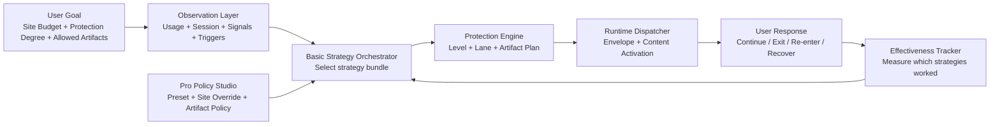

# Basic Strategy Orchestrator PRD

- Status: Draft
- Date: 2026-03-07
- Scope: Basic Mode automatic strategy selection, recovery loop, and effectiveness learning
- Depends on:

- Owner: dashboard product
- Last validated against code: 2026-03-16
- Path policy: planning-allowed

  - `docs/product/dashboard/basic-mode-automatic-protection-prd.md`
  - `docs/product/dashboard/basic-protection-strategy-prd.md`
  - `docs/product/dashboard/pro-mode-policy-studio-prd.md`
  - `docs/archive/evidence/protection-cutover-report.md`
  - `docs/archive/legacy-plans/protection-runtime-unified-refactor-master-plan.md`
- Non-goal:
  - raw filter parameter tuning UI
  - engine core contract 재설계
  - artifact renderer / worldbuilding 리디자인

## 현재 설명과의 관계

이 문서는 2026-03의 Basic/Pro 전략 제안이며 현재 릴리스의 기능·정책 계약이 아니다.
특히 §11의 효과 학습과 자동 보정은 채택된 동작으로 읽지 않는다.
[효과 연구 backlog](../backlog/friction-effect-research-backlog.md)의 보류 범위와
[현재 제품 원칙](../project-introduction.md)이 우선하며, 재검토에는 관측·효과 해석·정책 권한의 별도 설계가 필요하다.

## 1) 제품 한 줄 정의

`Basic Mode는 사용자가 목표 시간만 정하면, Strategy Orchestrator가 가장 덜 거슬리면서도 실제로 시간을 줄이는 보호 전략을 자동 선택·조합·조정하는 모드다.`

## 2) 목표 체감

Basic의 성공은 사용자가 “설정을 잘했다”가 아니라 아래처럼 느끼는 것이다.

- `그냥 목표 시간만 넣었는데 조금씩 줄어든다.`
- `막혀서 짜증나기보다 덜 빨려들어간다.`
- `삭제하고 싶은 충동 없이 계속 켜둘 수 있다.`
- `몇 주 지나면 실제 사용량이 내려간다.`

Basic의 목표는 사용자가 선택한 보호를 지속 가능하게 유지하도록 돕는 것이다.

## 3) 왜 Strategy Orchestrator가 필요한가

현재 Protection Engine은 `level / lanes / artifacts`를 계획하는 실행 엔진으로는 충분히 탄탄하다.
하지만 Basic 체감까지 책임지려면, 그 위에서 `지금 어떤 종류의 전략을 써야 하는가`를 선택하는 계층이 하나 더 필요하다.

threshold만으로 작동하면:
- 너무 기계적이다
- 사이트/패턴/세션 특성 차이를 흡수하지 못한다
- 사용자가 “왜 이렇게 갑자기 거칠어졌지?”를 느끼기 쉽다

반대로 과도한 원인 추론을 하면:
- 시스템이 사용자를 멋대로 해석한다는 인상을 준다
- 과잉 개입이 발생한다
- 설명 가능성이 떨어진다

그래서 Basic은 아래 원칙으로 움직여야 한다.

- `애매한 신호는 강도 조절 근거로만 사용`
- `명확한 신호만 구조 개입 근거로 사용`
- `어떤 전략이 실제로 효과 있었는지 계속 측정`

## 4) 핵심 아키텍처

## 5) 시스템 구성요소

### 5.1 Observation Layer

수집 역할만 담당한다.

입력:
- 오늘 사이트 사용시간
- 현재 세션 길이
- 재진입 빈도
- CLSE agitation
- direct trigger
  - `INFINITE_SCROLL_DETECTED`
  - `SHORT_FORM_ENTRY`
  - `VIDEO_SEEK_ABUSE`
  - `BUDGET_NEAR_EXHAUSTED`
  - `BUDGET_EXCEEDED`

원칙:
- 관찰만 한다
- 해석과 정책 선택은 다음 계층으로 넘긴다

### 5.2 Basic Strategy Orchestrator

Basic의 핵심 제품 로직이다.

역할:
- 현재 상태를 해석한다
- 어떤 전략 묶음을 얼마 동안 적용할지 정한다
- 과잉 개입을 피하면서 예산 안으로 수렴시킨다

출력:
- `strategySet`
- `strategyIntensity`
- `strategyDurationHint`
- `recoveryPrompt`
- `explanation`

### 5.3 Protection Engine

기존 구조를 그대로 사용한다.

역할:
- strategy output을 `level / lane / artifact plan`으로 컴파일한다
- envelope를 만들고 runtime으로 보낸다

### 5.4 Effectiveness Tracker

전략의 실효성을 본다.

측정값:
- 개입 후 이탈률
- 개입 후 재진입까지 걸린 시간
- 목표 초과 감소량
- 세션 길이 감소량
- 반복 저항률

### 5.5 Recovery Router

개입 뒤 다음 행동을 바꾼다.

예:
- 닫기
- 5분 회복
- 대시보드 이동
- 생산 사이트 전환
- 내일 예산 조정 제안

## 6) Strategy System

Basic은 개별 필터를 직접 선택하지 않는다.
대신 전략 단위로 생각한다.

### 6.1 전략군

1. `Reward Suppression`
- 좋아요/조회수/노출 지표 억제
- 시각 매력 저하

2. `Pace Control`
- 클릭 의도 게이트
- 스크롤 관성
- 탐색 속도 저하

3. `Session Fracture`
- 무한스크롤 개입
- 흐름 끊기

4. `Short-form Shield`
- 숏폼 진입 차단
- seek abuse 대응

5. `Recovery Redirect`
- 개입 후 다음 행동 유도

6. `Hard Stop`
- 목표 초과 후 최대 보호

### 6.2 전략 선택 원칙

- 초반에는 `Reward Suppression` 중심
- 예산 근접 시 `Pace Control` 강화
- 명확한 direct trigger가 있으면 `Session Fracture` 또는 `Short-form Shield`
- 목표 초과 후에는 `Recovery Redirect` 우선
- `Hard Stop`은 마지막 수단

### 6.3 절대 원칙

- Basic은 기본적으로 `거슬리지 않게` 시작한다
- 즉시 강한 차단보다 `조용한 압력`을 먼저 준다
- 같은 개입이 계속 실패하면 다른 전략군으로 전환한다

## 7) 입력 모델

### 7.1 사용자 입력

Basic에서 사용자는 아래만 정한다.

- 사이트별 목표 시간
- 보호 정도
  - `Soft`
  - `Balanced`
  - `Strict`
- 허용된 artifact

개입 부담에 대한 자발적 피드백은 별도 입력으로 검토한다. 피드백이 없으면 `toleranceScore`는
미관측이며, 이탈·비활성화 행동에서 부담이나 짜증을 대신 추정하지 않는다.

### 7.2 시스템 해석값

Orchestrator는 내부적으로 아래 값을 만든다.

- `budgetPressure`
- `patternPressure`
- `reentryPressure`
- `recoveryScore`
- `toleranceScore`

### 7.3 해석 원칙

- `budgetPressure`: 오늘 얼마나 목표에 가까운가
- `patternPressure`: 숏폼/seek/scroll 등에서 관측한 반복 패턴의 정도; 도파민이나 내적 동기의 추정치가 아님
- `reentryPressure`: 개입 후 얼마나 빨리 다시 돌아오는가
- `recoveryScore`: 개입 후 관측한 이탈·재진입 패턴; 정서적 회복의 측정값이 아님
- `toleranceScore`: 현재 전략의 부담에 대한 명시적 사용자 피드백; 행동만으로 짜증을 판정하지 않음

## 8) 보호 정도의 의미

Basic의 `Soft / Balanced / Strict`는 필터 강도 프리셋이 아니라 `오케스트레이터 성향`이다.

### 8.1 Soft
- 늦게 상승
- 더 긴 관찰 후 개입
- Recovery 유도 비중 높음

### 8.2 Balanced
- 기본값
- 예산과 패턴을 균형 있게 반영
- 일반 사용자 권장

### 8.3 Strict
- 더 빠른 상승
- direct trigger에 민감
- 하드 스탑 진입도 더 빠름

## 9) Orchestrator 상태 기계

### 9.1 기본 상태

- `Observe`
- `Guide`
- `Constrain`
- `Interrupt`
- `Recover`
- `Lock`

### 9.2 상태 의미

#### Observe
- 개입 거의 없음
- reward suppression만 약하게

#### Guide
- 예산 근접
- 저강도 pace control 시작

#### Constrain
- 세션 과열 또는 패턴 악화
- pace control 강화
- artifact arm 가능

#### Interrupt
- direct trigger 발생
- loop break / short-form shield / sentinel flare

#### Recover
- 개입 직후
- 다시 빠져들지 않게 행동 전환 유도

#### Lock
- 목표 초과 또는 명시적 하드 상태
- 최대 보호

## 10) Recovery Flow

Basic이 진짜 좋아지려면 `막은 후`가 중요하다.

### 10.1 Recovery 기본 액션

- `잠시 멈추기`
- `대시보드로 이동`
- `생산 사이트 열기`
- `오늘 목표 다시 보기`
- `내일을 위한 조정 제안`

### 10.2 Recovery 설계 원칙

- guilt copy 금지
- punishment tone 금지
- 짧고 단순하게
- 선택지는 적게
- 원래 루프보다 더 쉬운 다음 행동 제공

## 11) Effectiveness Learning

Basic은 장기적으로 같은 사용자에게 더 잘 맞아야 한다.

### 11.1 학습 대상

- 어떤 전략군이 실제로 세션을 줄였는가
- 어떤 artifact가 반발을 많이 불렀는가
- 어느 시간대에 어떤 전략이 잘 먹히는가
- 같은 사이트라도 어떤 패턴에서 어떤 개입이 잘 먹히는가

### 11.2 학습 단위

- site
- time band
- strategy bundle
- artifact use

### 11.3 학습 원칙

- on-device only
- 로컬 통계만 사용
- 설명 가능한 조정만 허용
- 갑작스러운 대변화 금지
- 작은 보정만 허용

## 12) Pro와의 관계

Pro는 Basic을 대체하는 모드가 아니라, Basic의 전략 번들을 설계하는 Policy Studio다.

정리하면:
- Basic은 `Strategy Orchestrator`를 자동 운용한다
- Pro는 `Orchestrator가 어떤 전략 번들을 쓸지`를 설계한다

즉 Pro preset은 결국 아래를 정의하는 것이다.
- posture
- lane curve
- artifact defaults
- schedule/context override
- recovery preference

## 13) 기본 내장 전략 번들

Basic은 처음부터 완전히 비어 있으면 안 된다.

권장 기본 번들:
- `Balanced Default`
- `Work Focus`
- `Night Recovery`
- `Social Lite`
- `Hard Reset`

다만 Basic 사용자에겐 이름을 강하게 드러내지 않는다.
내부적으로는 이 전략들을 자동 선택하거나 추천한다.

## 14) 성공 지표

아래는 검토할 지표다. 사용시간 감소나 이탈률 증가만으로 성공을 판정하지 않고, 사용자가 정한
목적·사전 약속, 필요한 이용의 보존과 개입 부담을 함께 살핀다.

### 14.1 행동 지표

- 사이트별 평균 사용시간 감소
- 목표 초과율 감소
- 세션 길이 감소
- 하드 락 진입률 감소
- 개입 후 이탈률 증가
- 재진입 간격 증가

### 14.2 제품 지표

- 설정 유지율 증가
- 기능 비활성화율 감소
- 관측 가능한 설정 비활성화·해제 횟수 감소; 그 동기나 충동의 측정값으로 해석하지 않음
- Basic Mode 유지율 증가

### 14.3 체감 지표

- "거슬린다" 피드백 감소
- "자연스럽게 줄어든다" 피드백 증가
- "막기만 한다" 인상 감소

## 15) 구현 우선순위

### Phase 1
- Strategy taxonomy 도입
- Orchestrator output contract 정의
- Recovery flow 기본 구현

### Phase 2
- Effectiveness tracker 도입
- strategy-to-engine compiler 정리
- Basic default bundle 세팅

### Phase 3
- site/time-band별 미세 적응
- strategy effectiveness replay
- Pro preset과 orchestrator 연결 강화

## 16) 구현 가드레일

- 사용자가 허용하지 않은 artifact를 임의 활성화하지 않는다
- direct trigger 없는 과잉 구조개입 금지
- hard stop은 마지막 수단으로 유지한다
- Basic 설명 문구는 내부 용어 대신 결과 중심으로 쓴다
- 학습 로직은 작은 보정만 허용한다

사용자가 명시한 차단 시간·접근 경계는 적응 전략의 완화를 기다리지 않고 정본 정책대로 집행한다.
위의 ‘Hard Stop은 마지막 수단’은 그 경계 안에서 제안한 전략 순서이며, 사전 약속의 우회 근거가 아니다.

## 17) 최종 결론

Basic의 본질은 `자동 threshold 시스템`이 아니라 `사용자를 예산 안으로 자연스럽게 수렴시키는 폐루프 전략 시스템`이다.

그리고 Pro의 본질은 `강한 수동 설정 모드`가 아니라, 그 폐루프를 설계하는 `Policy Studio`다.
